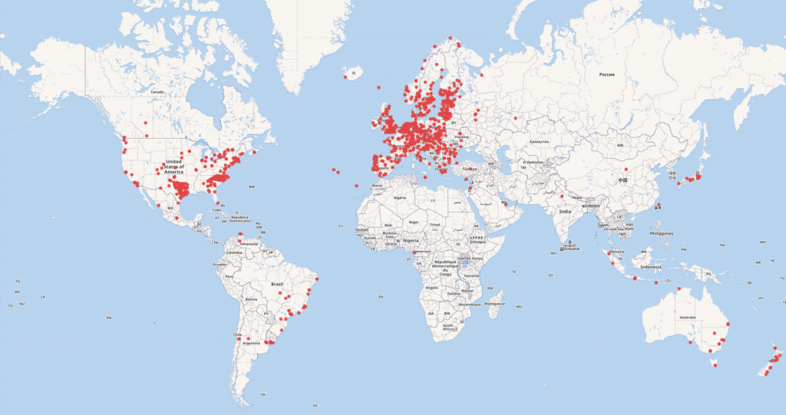
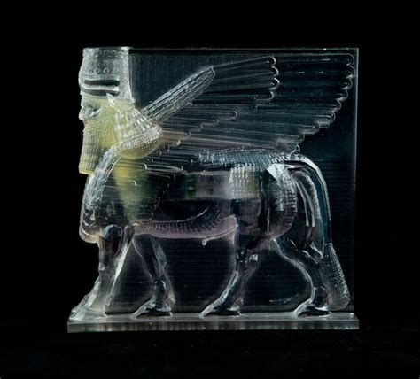

# Inventaire et traitement des données

### MSL6517 – automne 2026

Zoë Renaudie

https://studium.umontreal.ca/course/view.php?id=351279

/** Notes **/
Contenu vient en partie du cours d'Emmanuel Château-Dutier

===vvvvvv===

<!-- .slide: class="text-small" -->
| Semaine  | Séance      | Thème                                                        | TP rendu                    |
| -------- | ----------- | ------------------------------------------------------------ | --------------------------- |
|          |             | ~~Introduction~~                                             | ~~Présentation → 14 sept.~~ |
| 14 sept. | S1          | ~~Présentation générale des enjeux numériques dans les musées~~ | ~~TP1 → 21 sept.~~          |
| 21 sept. | S2          | ~~La documentation muséale~~                                 | ~~TP2 → 28 sept.~~          |
| 28 sept. | S3          | ~~La gestion de collection : inventaire, normes, modèles métiers~~ | ~~TP3 → 05 oct.~~               |
| 05 oct.  | S4 (async.) | ~~Les interfaces publiques et catalogues en ligne~~              | ~~TP4 → 12 oct.~~               |
| 12 oct.  | S5 (async.) | ~~La notion de métadonnées~~                                     | ~~TP5 → 26 oct.­­~~               |
| 19 oct.  |             | ~~Semaine de lecture~~                                       |                             |
| 26 oct.  | S6          | ~~Données structurées, langages documentaires et thesaurus~~     | ~~TP6 → 02 nov.~~               |
| 02 nov.  | S7          | Open GLAM : Open data et Open Content                        | TP7 → 09 nov.               |
| 09 nov.  | S8          | Modélisation de données                                      | TP8 → 16 nov.               |
| 16 nov.  | S9          | Le modèle relationnel                                        | TP9 → 23 nov.               |
| 23 nov.  | S10         | Les ontologies dans le domaine patrimonial                   | TP10 → 30 nov.              |
| 30 nov.  | S11         | Éthique des données et pérennisation                         |                             |
| 07 déc.  | S12         | L'intelligence artificielle et les enjeux du traitement des données |                             |
| 21 déc.  |             | **Rendu du travail final**                                   |                             |

===vvvvvv===

# Open GLAM : L’Open data et l’Open Content dans la stratégie muséale

/** Notes **/

===vvvvvv===

## Déroulement de la séance

1. Intervention de la **Maison MONA** : vers un commun numérique de l'art public
PAUSE
2. Open GLAM : l'open data et l'open content dans la stratégie muséale
3. Ouvrir pour que les données circulent : l'interopérabilité
4. Du Linked Open Data au Linked Open Usable Data
5. Retour sur votre exercice OpenRefine 
6. Consignes du TP7

/** Notes **/
===vvvvvv===

## Intervention de la Maison MONA

### Vers un commun numérique de l'art public

[lien présentation](https://www.canva.com/design/DAG4C5JMHzA/ke0LJC65IwQU87_cCNsrBw/view?utlId=h13ee9d1525)

https://monamontreal.org/index.html

/** Notes **/

===vvvvvv===

### La Maison MONA en bref

- OSBL qui valorise l'art public et le patrimoine
- Débute à Montréal, s'ouvre à l'ensemble du Québec
- Projet né lors d'un cours de code numérique
- Financement : Pépinière numérique

**Partenaires** : UdeM, LINCS, Art et site, DIRO, Ad Mare (centre d'artistes des Îles-de-la-Madeleine), Conseil des arts du Canada

===vvvvvv===

### Données et alignements

- Jeux de données gouvernementaux
- Données du Bureau d'art public de Montréal, mais aussi murales et art public de Rimouski
- Alignement des données récupérées par API
- Travail avec LINCS, infrastructure canadienne de données liées reposant sur CIDOC-CRM
- Saisie de données dans Wikidata

===vvvvvv===

### Équité, diversité et biais

- Concentration sur les artistes, avec des enjeux d'équité et de diversité : femmes, personnes issues de la diversité, régions
- Biais dans Wikidata

/** Notes **/
Ressource évoquée : https://capacoa.ca/fr/secteur-sain/ressources-autochtones/

**Questions** :
- Quels liens avec votre exercice sur les artistes du MAC ?
- Quels biais avez-vous observés dans la réconciliation avec Wikidata ?

===vvvvvv===

## Open GLAM : l'open data et l'open content dans la stratégie muséale

===vvvvvv===

## La logique du partage

/** Notes **/
L'Open GLAM transforme la manière dont les musées, bibliothèques, archives et galeries partagent leurs collections.

La logique du partage porte des promesses généreuses : démocratie, équité, pluralisme, ouverture, accessibilité et care.

**La question du partage est éminemment politique.** Elle interroge qui a accès à la culture, qui peut l'utiliser, la transformer, la partager.

===vvvvvv===

## Votre lecture

Després-Lonnet, Marie, Béatrice Micheau, et Marie Destandau. 2017. « Interopérabilité et logiques organisationnelles. Ce qu’ouvrir ses données veut dire ». Revue COSSI : Communication, Organisation, Société du Savoir et Information, no 2, Bricolages, improvisations et résilience organisationnelle face aux risques informationnels et communicationnels. https://revue-cossi.numerev.com/articles/revue-3/1826-interoperabilite-et-logiques-organisationnelles

===vvvvvv===

### Le contexte historique : Aaron Swartz

> There is no justice in following unjust laws. It's time to come into the light and, in the grand tradition of civil disobedience, declare our opposition to this private theft of public culture.
>
> We need to take information, wherever it is stored, make our copies and share them with the world. [...] We need to fight for Guerilla Open Access.

Swartz, Aaron. 2008. « Guerilla Open Access Manifesto ». https://pastebin.com/cefxMVAy.

/** Notes **/
Aaron Swartz (1986-2013), informaticien et activiste. Arrêté en 2011 pour avoir téléchargé massivement des articles depuis JSTOR. Face à des poursuites disproportionnées, il met fin à ses jours en 2013, à 26 ans.

Alexandra Elbakyan, fondatrice de [Sci-Hub](https://sci-hub.se/), qui met en accès libre des publications universitaires payantes.

===vvvvvv===

## Les fondements théoriques des communs culturels

### Les biens communs informationnels

> "Tout comme les mots 'environnement' et 'nature' prennent différents sens pour répondre à différents espoirs et à différentes peurs, les différentes images du domaine public et des biens communs expriment chacune un ensemble spécifique de craintes des dangers de la propriété et d'espoirs concernant les processus créatifs."
James Boyle

/** Notes **/
Depuis 1985, plusieurs penseurs américains (Lange, Eisenberg, Benkler, Lessig, Boyle, Starr) construisent une critique des « enclosures » dans la société de l'information.

===vvvvvv===

## Biens communs

- **Biens communs** : toute chose ou entité immatérielle à laquelle on a décidé de donner un statut de propriété commune, appartenant à tous parce qu'elle n'appartient à personne.
- **Biens communs informationnels** : biens qui peuvent être créés, échangés et manipulés sous forme d'information (données, connaissances, créations, logiciels).

(Aigrain 2005, p. 265)

===vvvvvv===

### Les droits intellectuels positifs (Aigrain 2005)

1. Le droit de créer de nouvelles entités intellectuelles
2. Le droit de rendre sa création publique
3. Le droit d'être reconnu comme créateur
4. Le droit d'obtenir récompense pour une création
5. **Le droit d'accéder à toute entité intellectuelle rendue publique**
6. **Le droit de citer des extraits pour l'information, l'analyse, la critique, l'enseignement**
7. Le droit de redresser toute erreur ou information fausse
8. Le droit de référencer et créer des liens

===vvvvvv===

### La contribution d'Elinor Ostrom

Prix Nobel d'économie 2009 pour ses travaux sur la gouvernance des communs.

- Les communs informationnels ne perdent pas de valeur à l'usage, ils s'enrichissent
- Pas de « malédiction des biens communs » dans le domaine numérique
- Une gouvernance partagée des ressources communes est possible et efficace

===vvvvvv===

## Open Access et Open Data

- **1991** : arXiv | **1999** : Open Archives Initiative | **2000** : PLoS | **2001** : Creative Commons
- **2002** : Budapest | **2003** : Bethesda et Berlin | **2014** : Lyon
- **2007** : Sebastopol, définition de l'Open Data | **2009** : data.gov
- **2010** : la DNB publie ses données d'autorités en données liées
- **2011** : la British National Bibliography en CC0 (2,8 M de titres)

/** Notes **/
La déclaration de Berlin encourageait déjà « les détenteurs du patrimoine culturel à soutenir l'accès libre en fournissant leurs ressources sur Internet ».

===vvvvvv===

## La révolution dans les musées depuis 2012

### Open **G**alleries, **L**ibraries, **A**rchives, and **M**useums **+**

**GLAM** : _Galleries, Libraries, Archives, Museums_  
**Open GLAM** : mouvement international plaidant pour l'ouverture des données culturelles

**Principes** :
- Les données culturelles publiques sont un **bien commun**
- Leur diffusion relève de l'**intérêt général**
- L'ouverture favorise l'innovation, la recherche, la participation citoyenne

/** Notes **/
Le + dans Open GLAM : Lena Krause et Julie Graff. 
Ce qui semblait marginal il y a dix ans est devenu mainstream.

===vvvvvv===

### Les pionniers et l'accélération

- **2008** : Powerhouse Museum (Sydney) rejoint The Commons sur Flickr
- **2012** : Walters Art Museum et Wikipédia ; Rijksmuseum (125 000 œuvres, aujourd'hui 650 000) ; NYPL ; British Library (Public Domain Mark)
- **2013** : National Gallery of Art (25 000 images HD) ; Getty (10 000 images, aujourd'hui 110 000) ; BnF (métadonnées en licence ouverte) ; Smithsonian (visionneuse 3D)
- **2016** : MoMA | **2017** : MET Open Access
- **2020** : Smithsonian Open Access (5,1 M d'images aujourd'hui) ; Paris Musées (plus de 170 000 reproductions)
- **2023** : Open GLAM Survey, plus de 1 600 institutions dans 56 pays, plus de 95 millions d'objets numériques

/** Notes **/
Le New York Times titre en mai 2013 : « Les œuvres d'art pour un et pour tous ».

Pour des raisons juridiques et stratégiques, le mouvement est d'abord américain, puis gagne l'Europe. Il s'organise autour d'openglam.org et de groupes de travail mensuels.

===vvvvvv===

### Le mouvement Open GLAM et les licences libres

**Chronologie récente** :
- 2010-2011 : Bibliothèques nationales (Allemagne, UK, Suède) publient en CC0
- 2012 : Europeana adopte CC0, Rijksmuseum libère 125 000 œuvres
- 2013-2015 : Getty, British Library, National Gallery Washington
- 2015-présent : Démocratisation, de plus en plus d'institutions suivent

Plusieurs musées publient leurs données sur **GitHub** (Cooper Hewitt, MoMA, Tate, Rijksmuseum, Carnegie Museum), offrant :
- Transparence et versionnement
- Collaboration communautaire
- Accessibilité (formats ouverts, téléchargement direct)

===vvvvvv===

Visualisation de l'Open GLAM Survey dans Wikidata, mai 2024 (https://w.wiki/7CX7)

/** Notes **/
Le mouvement s'élargit : gouvernance des données, équité, principes FAIR et CARE, droits des communautés autochtones.

https://douglasmccarthy.com/projects/open-glam-survey/
https://www.wikidata.org/wiki/Q73357989

===vvvvvv===

### Situation au Canada et au Québec

[Value Study of GLAMs in Canada, rapport pour l'Ottawa Declaration Working Group, décembre 2019](https://museums.ca/site/reportsandpublications/studyglamscanada2020?language=en_CA)

/** Notes **/
Mouvement présent mais inégalement structuré. Peu d'institutions ont une politique d'accès ouvert globale, la plupart procèdent au cas par cas. Au Québec, les exemples de licences libres ou d'open data patrimonial restent rares.
C'est en train de changer ! 
===vvvvvv===

### Cas d'étude : Musée d'art contemporain de Montréal (2018)

[portail open.canada.ca](https://open.canada.ca/data/en/dataset/3b475449-f7e0-4f68-b9e8-933dda1916d0)

/** Notes **/
Le MAC a ouvert une partie de ses données : plateforme MACrépertoire (collection, artistes, expositions, publications) et jeu de données sur open.canada.ca. C'est le jeu de données utilisé dans votre exercice OpenRefine : ce qu'on y trouve, ce qui y manque.

===vvvvvv===

### Cas d'étude : Smithsonian Open Access (2020)

https://www.si.edu/openaccess

- Images 2D et 3D, métadonnées, données de recherche, sous CC0
- 19 musées, 9 centres de recherche, bibliothèques, archives, zoo national
- API complète et dépôt GitHub

/** Notes **/
partenariat avec Google Arts & Culture, projet AstroNuts, Georgetown Maker Hub.

Paris Musées (2020) et RAMM, Exeter (2023-2024)
(reproductions CC0 publiées série par série pour vérifier le statut juridique ; projet pilote de 63 images, business case documenté dans un White Paper du GLAM-E Lab).

===vvvvvv===

### Pourquoi ce mouvement s'accélère-t-il ?

1. **Pressions économiques** : les licences d'images génèrent peu de profits
2. **Coûts de gestion** des droits et reproductions
3. **Attentes publiques** : participer, pas seulement regarder
4. **Visibilité en ligne**  face aux plateformes commerciales
5. **Financement public** : exigences des bailleurs de fonds
6. **Succès démontrés** par les pionniers
7. **Pression communautaire** : Wikipédia et communautés ouvertes
8. **Cadres juridiques** : directive européenne Copyright 2019

/** Notes **/

IA
===vvvvvv===

## Définir l'« ouverture »

### Qu'est-ce qu'être vraiment ouvert ? (Kapsalis 2016)

**Œuvres du domaine public** : accès et utilisation sans restriction, souvent exprimés par une licence CC0

**Œuvres sous copyright** : accès et utilisation conformes au fair use (non commercial, éducatif et/ou transformatif)

===vvvvvv===

### Les libertés fondamentales 

1. **Utiliser et représenter** l'œuvre
2. **Étudier** l'œuvre
3. **Distribuer des copies**
4. **Distribuer des travaux dérivés**

/** Notes **/
Implications techniques : disponibilité des données sources, formats libres, absence de DRM, aucune restriction contractuelle.

(Definition of Free Cultural Works, 2010)

===vvvvvv===

### Le « copyfraud »

Quatre types d'infractions (Mazzone 2015) :

1. Fausse déclaration de possession d'un contenu du domaine public
2. Restrictions non prévues par la loi
3. Privatisation d'un contenu en arguant de la détention d'une copie
4. Privatisation d'un contenu par son nouveau support

/** Notes **/
Exemples : la RMN revendiquant des droits sur des reproductions d'œuvres du domaine public ; la BnF et le « droit des données publiques ».

- Langlais, Pierre-Carl. 2017. « L'inverse du piratage, c'est le copyfraud, et on n'en parle pas ». *L'Obs*.
- Mazzone, Jason. 2015. « Copyfraud ». *NYU Law Review* 81 : 1026. https://papers.ssrn.com/abstract=787244.

===vvvvvv===

### La directive européenne Copyright (2019), article 14

> Lorsque la durée de protection d'une œuvre d'art visuel est arrivée à expiration, tout matériel issu d'un acte de reproduction de cette œuvre ne peut être soumis au droit d'auteur ni aux droits voisins, à moins que ce matériel ne soit original.

- Première reconnaissance positive du domaine public dans l'ordre juridique européen
- Lutte contre le copyfraud
- Limite : ne s'applique qu'aux arts visuels

/** Notes **/
Adoptée par le Parlement européen le 26 mars 2019 (348 voix contre 274).

===vvvvvv===

### Cas pratique : le Metropolitan Museum

- **2014** : annonce de 400 000 œuvres « libres », mais avec des restrictions cachées
- **2017** : nouvelle politique, plus de 406 000 images en haute résolution, CC0 1.0, réutilisation commerciale sans autorisation

/** Notes **/
CC0 présuppose que le musée a des droits à abandonner. La Public Domain Mark aurait été plus appropriée : elle constate l'appartenance au domaine public sans présupposer de droits.

===vvvvvv===

### Manifestes et chartes

- **Public Domain Manifesto** (COMMUNIA, 2010) : domaine public structurel
- **Europeana Public Domain Charter** (2015) : la numérisation ne crée pas de nouveaux droits
- **Déclaration ReACH** (2017) : reproduction, stockage et partage numérique du patrimoine, 150 ans après la Convention de Henry Cole (1867)

===vvvvvv===

### Material Speculation: ISIS (2015-2016), Morehshin Allahyari

/** Notes **/
Modélisation et impression 3D de 12 artefacts d'Hatra et de l'Empire assyrien détruits par ISIS en 2015 (merci Christelle Proulx). Allahyari est artiste, activiste et écrivaine irano-kurde basée à Brooklyn.

https://www.digitalearth.art/break-the-digital-monoculture-morehshin-allahyari

===vvvvvv===

### Des gestes critiques

- **Display At Your Own Risk** (Andrea Wallace et Ronan Deazley, 2016) : exposition d'œuvres dont la reproduction est restreinte par copyfraud
- **The Other Nefertiti** (Jan Nikolai Nelles et Nora Al-Badri, 2015) : scan 3D clandestin du buste de Néfertiti, diffusé en open source

https://displayatyourownrisk.org/about-dayor/
http://nefertitihack.alloversky.com/

/** Notes **/
DAYOR : une seule soirée à Glasgow le 8 juin 2016, version française par SavoirsCom1 en 2017. Acte de désobéissance civile culturelle, questionnement sur la propriété culturelle.

===vvvvvv===

### Plateformes de partage et projets

- **Flickr The Commons** (2008) : plus de 150 partenaires
- **Wikimedia Commons** (2004) : plus de 90 millions de fichiers (2023), Wiki Loves Monuments depuis 2010
- **Crotos** : recherche dans les collections muséales de Wikimedia Commons à partir de Wikidata, http://zone47.com/crotos/

===vvvvvv===

### Le Smithsonian Transcription Center

- Lancé en 2013 : 14 000 bénévoles, 500 000 pages transcrites, 130 000 nouvelles entrées de catalogue
- Métadonnées et transcriptions dans le domaine public

### Le « digital labor »

- Critique : exploitation de travail gratuit
- Réponse : participation volontaire, résultats remis au public en accès ouvert

/** Notes **/
Le contexte d'ouverture légitime la contribution : si le musée gardait les résultats propriétaires, la critique serait justifiée.

===vvvvvv===

### Quels défis persistent ?

<iframe src="https://mimionuoha.com/the-library-of-missing-datasets" width="800px" height="500px"></iframe>

https://mimionuoha.com/the-library-of-missing-datasets

/** Notes **/
**Juridiques** : harmonisation des législations, copyfraud, clarification du domaine public.

**Organisationnels** : changement de culture, formation, infrastructure, métadonnées, licences claires.

**Éthiques** : *digital colonialism* (inégalités de ressources, histoire coloniale, souveraineté des données, droits autochtones), équilibre entre ouverture et protection, restitution vs numérisation.

Reprendre ici les enjeux d'équité et de biais soulevés par la Maison MONA.

===vvvvvv===

### RightsStatements.org

12 déclarations de droits standardisées pour le patrimoine culturel numérique, utilisées par Europeana et la DPLA.

===vvvvvv===
### L'Open Data

L'**open data** désigne la mise à disposition de données numériques selon une méthode et une licence ouverte garantissant leur libre accès et réutilisation.

**Les 5 étoiles de Tim Berners-Lee** (échelle de maturité) :

★ Données disponibles sur le web, licence ouverte  
★★ Données structurées (ex : Excel plutôt qu'image scannée)  
★★★ Format non propriétaire (ex : CSV plutôt qu'Excel)  
★★★★ Utilisation d'URI pour identifier les choses  
★★★★★ Liens vers d'autres données (_Linked Open Data_)

**Tendance** : Les institutions culturelles visent désormais le niveau 4 ou 5 étoiles, en publiant leurs données sous forme de **données liées**.

===vvvvvv===

## Ouvrir pour que les données circulent : l'interopérabilité

/** Notes **/
Ouvrir ne suffit pas : encore faut-il que les données puissent être échangées et comprises par d'autres systèmes.

===vvvvvv===

### Interopérabilité

> Capacité d'échanger des données entre systèmes multiples disposant de différentes caractéristiques en termes de matériels, logiciels, structures de données et interfaces, avec le minimum de perte d'informations et de fonctionnalité.

Source : BON, Hugo (2016). « Les métadonnées, un enjeu crucial pour la vidéo », INA Global.

**Compatibilité** : deux systèmes de types différents peuvent communiquer.
**Interopérabilité** : des systèmes peuvent communiquer sans dépendre d'un acteur particulier.

===vvvvvv===

### Pourquoi est-ce crucial en muséologie ?

- Multiplication des plateformes de gestion des collections
- Nécessité de partager les données avec d'autres institutions
- Demande croissante d'accès public aux collections
- Projets collaboratifs et recherches interdisciplinaires
- Préservation à long terme des données patrimoniales

===vvvvvv===

### Les niveaux d'interopérabilité

[Cadre d'interopérabilité européen](https://wiki.gccollab.ca/index.php?title=Éléments_pour_un_cadre_d'interopérabilité_technique_pour_Patrimoine_Canadien) :

- cadre politique
- interopérabilité **juridique** (reprend la partie précédente : licences, droits)
- interopérabilité **organisationnelle** : accords de partage, politiques communes, licences harmonisées
- interopérabilité **sémantique** : vocabulaires contrôlés, référentiels partagés (AAT, Wikidata), alignement de concepts
- interopérabilité **technique** : formats (XML, JSON, CSV), protocoles (HTTP, OAI-PMH), APIs, encodage

/** Notes **/
Les problèmes ne sont pas uniquement techniques, ils relèvent de préoccupations à plusieurs échelles.

Exemple sémantique : « huile sur toile » selon le Getty AAT plutôt que des variantes locales ; référence d'un nom d'auteur. Exemple technique : un système de gestion de collections (TMS, CollectiveAccess) qui exporte vers une plateforme web.

===vvvvvv===

### Standards et formats d'échange

- **Dublin Core** : 15 éléments, niveau minimal interopérable, « langage pivot »
- **LIDO** : schéma XML pour les objets muséaux, profil dérivé du CIDOC-CRM ; utilisé par Europeana et Joconde
- **EDM** : modèle RDF d'Europeana pour l'agrégation, distingue objet physique et représentation numérique
- **OAI-PMH** : protocole de moissonnage de métadonnées par les agrégateurs

/** Notes **/

Un format d'échange est une convention commune qui permet à des systèmes (ou des personnes) qui ne se comprennent pas naturellement de s'échanger des données.

Imaginez 50 musées qui veulent s'envoyer des informations sur leurs objets :
Sans format d'échange : chacun envoie ce qu'il veut, comme il veut : une lettre manuscrite, un fichier Word, un tableau Excel mal aligné, un fax… Le destinataire doit tout réinterpréter à la main. Chaos.

Avec format d'échange : on se met d'accord à l'avance sur une règle commune : les données partent dans un colis standardisé (mêmes rubriques, même ordre, même encodage). N'importe qui qui connaît la règle peut ouvrir le colis et le lire automatiquement.

Les noms à connaitre
**Dublin Core** : « interopérabilité faible mais robuste », socle stable pour exposer des données dans Artefacts Canada, Europeana ou la DPLA.

**LIDO** : décrit aussi les événements liés à l'objet (création, acquisition, exposition).
c'est le format demandé par Europeana et Joconde.

**EDM** : EDM distingue l'objet physique (le tableau dans le musée) de sa représentation numérique (la photo du tableau). Deux choses différentes ! excellent pour la publication, pas pour la gestion interne.

**OAI-PMH** : le musée expose ses métadonnées, les agrégateurs les moissonnent, les indexent, les rendent accessibles.

===vvvvvv===

### Un exemple canadien : DOPHEDA

- Projet du Réseau canadien d'information sur le patrimoine (RCIP)
- Données patrimoniales canadiennes en **données ouvertes et liées**, fondées sur **CIDOC-CRM**
- Deux facettes : **Actants** (personnes, groupes) et **Objets**, ce dernier volet prévu pour s'aligner sur **linked.art**

https://chin-rcip.github.io/collections-model/fr

/** Notes **/
**Question** : pourquoi commencer par les personnes et les groupes plutôt que par les objets ?

Le RCIP part des actants parce qu'il existe peu de jeux de données patrimoniales centrés sur les personnes. Réponse aussi à la question du champ « artiste » : un actant a une existence propre, avec des événements de vie et des relations, et pas seulement une ligne de texte dans une fiche d'objet.

===vvvvvv===

## Du LOD au LOUD

===vvvvvv===

### Linked Open Data

Principes, technologies et bonnes pratiques pour publier des données **ouvertes**, **structurées** et **reliées** sur le Web.

Les 4 principes (Tim Berners-Lee) :

1. Utiliser des **URI** pour nommer les choses
2. Utiliser **HTTP** pour rendre les URI accessibles
3. Fournir de l'information dans un **format standard** (RDF, JSON-LD)
4. Inclure des **liens** vers d'autres URI

/** Notes **/
Deux principes essentiels : données sous licence ouverte, et données reliées sur la base de normes communes (modèles et vocabulaires). Le LOD s'inscrit dans le Web sémantique : un Web de données, par opposition aux silos du Web 1.0.

===vvvvvv===

### Comment ça fonctionne

- **RDF** : triplets sujet, prédicat, objet (*Œuvre123* a pour créateur *Artiste456*)
- **Ontologies** : CIDOC-CRM, Dublin Core, SKOS, EDM
- **SPARQL** : langage d'interrogation des graphes RDF

**Pour les musées** : interopérabilité réelle entre institutions, documentation plus riche, transparence, durabilité

/** Notes **/
Exemple : le musée A publie ses œuvres en RDF, le musée B ses expositions, une bibliothèque les identifiants d'artistes. Un chercheur interroge l'ensemble comme un seul graphe.

===vvvvvv===

### Initiatives et projets

| Niveau | Exemples |
| --- | --- |
| **LOD complet** | Europeana (EDM, plus de 50 M d'objets), Natural History Museum de Londres (Data Portal, DOI pour les spécimens), Smithsonian NMNH, GBIF |
| **Partiellement LOD** | DPLA (Dublin Core, OAI-PMH, JSON) |
| **LOD-friendly** | Joconde (LIDO-MC, plus de 600 000 notices), Artefacts Canada (OAI-PMH), Videomuseum, Alienor |

/** Notes **/
Question de discussion : quelle différence entre les catalogues et jeux de données de musées d'art et de musées d'histoire naturelle ?

===vvvvvv===

### Du LOD au LOUD

**Linked Open Usable Data** (Sanderson 2019)

Standards conformes : API Présentation 3.0 d'**IIIF**, **Web Annotation Data Model** (W3C), **Linked Art** (profil RDF du CIDOC-CRM en JSON-LD avec les vocabulaires Getty)

/** Notes **/
La réutilisabilité des données liées s'améliore en appliquant les principes de conception du LOUD. Le LOD demande de nouvelles compétences que tous les musées n'ont pas, et la qualité des données doit être assurée pour que les données liées soient utiles.

Les pratiques locales de thésaurus se heurtent aux pressions des institutions internationales en faveur des normes.

- Juanals, B., et Minel, J.-L. 2018. « La construction d'un espace patrimonial partagé dans le Web de données ouvert ». *Études de communication* 50 : 71-94.
- Sanderson, R. 2019. « Shout it Out: LOUD ». Keynote, EuropeanaTech.

===vvvvvv===

## IIIF

Standard pour la diffusion et la manipulation d'images de haute qualité :
- Image API (demander dynamiquement différentes résolutions, recadrages)
- Presentation API (séquences d'images, métadonnées)
- Visualiseurs interopérables (Mirador, Universal Viewer)
- Comparaison d'images provenant de musées différents

/** Notes **/
<iframe src="https://iiif.io/demos/" width="800px" height="500px"></iframe>

Standard pour la diffusion et la manipulation d'images de haute qualité :
- Image API (demander dynamiquement différentes résolutions, recadrages)
- Presentation API (séquences d'images, métadonnées)
- Visualiseurs interopérables (Mirador, Universal Viewer)
- Comparaison d'images provenant de musées différents

IIIF (International Image Interoperability Framework) est un ensemble de normes ouvertes qui permettent de publier, d’interroger et de réutiliser des images et leurs métadonnées sur le web de façon interopérable. Il est porté par un consortium d’institutions patrimoniales (bibliothèques, musées, archives, universités).

Le principe. Plutôt que de télécharger des fichiers, on accède aux images par des URL standardisées. Un même visualiseur (Mirador, Universal Viewer) peut ainsi afficher, comparer ou annoter des images provenant d’institutions différentes.

Intérêts :
Interopérabilité entre institutions, sans duplication des images.
Comparaison côte à côte d’œuvres ou de documents dispersés.
Annotation et citation précise d’une région d’image, ce qui sert la recherche.
Écosystème logiciel ouvert (serveurs, visualiseurs, outils d’annotation).

IIIF décrit surtout la présentation et la structure d’un objet. Pour les métadonnées sémantiques riches, on le couple généralement à des modèles comme CIDOC-CRM ou à des entrepôts comme Wikidata, les manifestes pouvant y renvoyer.

Parmi les musées qui exposent leurs collections via IIIF (en tout ou en partie) :

Art Institute of Chicago : son API publique sert les images via l’Image API.
Rijksmuseum (Amsterdam) : images et données ouvertes accessibles en IIIF.
Harvard Art Museums et Yale Center for British Art : parmi les adoptants précoces, avec manifestes pour leurs collections.
National Gallery of Art (Washington) et Smithsonian : images servies par IIIF.
Getty : collections et ressources numérisées en IIIF.
Wellcome Collection (Londres) : manifestes pour l’ensemble de ses fonds numérisés.

Côté bibliothèques et archives, très actives dans IIIF : BnF (Gallica), British Library, Bodleian, Bibliothèque vaticane, ainsi que l’agrégateur Europeana.

Question : Quelle est la problématique ? Les images doivent être ouvertes. 

===vvvvvv===

## vers un nouveau modèle muséal

1. L'ouverture renforce les institutions plutôt qu'elle ne les affaiblit
2. La mission de service public est mieux remplie
3. De nouveaux publics sont touchés
4. L'engagement communautaire se développe
5. L'innovation est stimulée

**Mais** : ouvrir ne suffit pas, il faut aussi des données interopérables, de qualité, et équitables.

/** Notes **/
L'interopérabilité est une démarche collaborative, pas seulement technique.

Quel problème se pose aujourd'hui avec l'IA a votre avis ? 

===vvvvvv===

## Pour aller plus loin

- Open GLAM toolkit : https://meta.wikimedia.org/wiki/Open_GLAM_Toolkit
- Guide du GLAM-E Lab : https://www.glamelab.org/files/go-open-with-glam-e.pdf
- OpenGLAM : https://openglam.org | Creative Commons : https://creativecommons.org
- Public Domain Manifesto : https://publicdomainmanifesto.org | RightsStatements.org : https://rightsstatements.org
- LINCS : https://lincsproject.ca/ | Europeana Pro : https://pro.europeana.eu/ | LIDO : http://www.lido-schema.org/
- Feuille de route Données et contenus culturels (Ministère de la Culture, 2021)

**Lectures** :
- Kapsalis, Effie. 2016. « The Impact of Open Access on Galleries, Libraries, Museums, & Archives »
- Suber, Peter. 2012. *Open Access*. MIT Press
- Aigrain, Philippe. 2005. *Cause commune : l'information entre bien commun et propriété*
- Definition of Free Cultural Works : https://freedomdefined.org/Definition

===vvvvvv===

## Retour sur le TP6 : OpenRefine

- Décomposition de `lieu_naissance` et `lieu_mort`
- Réconciliation des noms d'artistes avec Wikidata
- Enrichissement : identifiant Wikidata, dates de naissance et de mort
- Différences entre les jeux de données

/** Notes **/
Question finale de l'exercice : comment le MAC pourrait-il améliorer ses bases de données d'artistes ? Quelles autres ressources externes pourraient servir à ces enrichissements ?

Faire le lien avec la Maison MONA : mêmes outils (Wikidata, alignement), même enjeu de qualité et de représentativité des données.

===vvvvvv===

## TP7 - Sélection d'une solution informatique de gestion de collection

Imaginez que vous occupez la direction d'un **petit musée local en région** (2 employés à temps plein). Votre institution dispose d'une collection modeste mais néanmoins relativement importante de plusieurs milliers d'artefacts. Le catalogage a jusqu'à présent été réalisé avec une solution informatique propriétaire utilisant une base de données relationnelle devenue obsolète. Votre établissement dispose cette année d'une opportunité de soutien financier pour réaliser une migration vers un système plus moderne.

#### Consignes

En consultant la documentation commerciale mise à disposition par **trois vendeurs** de produits qui vous ont été recommandés, et en vous aidant de la **grille d'évaluation de logiciels de gestion de collections du RCIP**, formaliser la sélection d'un logiciel et la justifier en vue de la rédaction du dossier de demande de subvention.

**Ressources :**

- Liste des critères d'évaluation de systèmes de gestion des Collections (RCIP)
- *Collections management software: vendor profiles*

Mettez vos résultats sur le pad : [https://annuel.framapad.org/p/mBJwa87C05042\_fMwcde](https://annuel.framapad.org/p/mBJwa87C05042_fMwcde)
