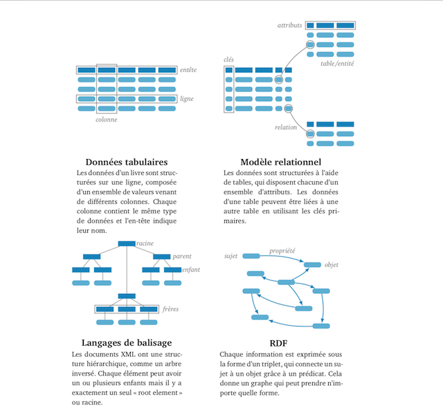

<style display="none">
.flex-1 {
  flex: 1;
}
.flex-1-5 {
  flex: 1.5;
}
#ouvroir {
  position: relative;
  right: 10%;
}
#cieco {
  max-width: 50%;
  position: relative;
  left: 5%;
}
#udem {
  margin-top: 0;
  position: relative;
  bottom: 15%;
}
.reveal h3 {
  margin-top: 1em;  
  }
.reveal .logos {
  margin-top: 2em;
}
</style>

# Inventaire et traitement des données

### MSL6517 – automne 2026

Zoë Renaudie

https://studium.umontreal.ca/course/view.php?id=351279

/** Notes **/
Contenu vient en partie du cours d'Emmanuel Château-Dutier

===vvvvvv===

<!-- .slide: class="text-small" -->
| Semaine  | Séance      | Thème                                                        | TP rendu                    |
| -------- | ----------- | ------------------------------------------------------------ | --------------------------- |
|          |             | ~~Introduction~~                                             | ~~Présentation → 14 sept.~~ |
| 14 sept. | S1          | ~~Présentation générale des enjeux numériques dans les musées~~ | ~~TP1 → 21 sept.~~          |
| 21 sept. | S2          | ~~La documentation muséale~~                                 | ~~TP2 → 28 sept.~~          |
| 28 sept. | S3          | ~~La gestion de collection : inventaire, normes, modèles métiers~~ | ~~TP3 → 05 oct.~~               |
| 05 oct.  | S4 (async.) | ~~Les interfaces publiques et catalogues en ligne~~              | ~~TP4 → 12 oct.~~               |
| 12 oct.  | S5 (async.) | ~~La notion de métadonnées~~                                     | ~~TP5 → 26 oct.­­~~               |
| 19 oct.  |             | ~~Semaine de lecture~~                                       |                             |
| 26 oct.  | S6          | ~~Données structurées, langages documentaires et thesaurus~~     | ~~TP6 → 02 nov.~~               |
| 02 nov.  | S7          | ~~Open GLAM : Open data et Open Content~~                        | ~~TP7 → 09 nov.~~              |
| 09 nov.  | S8          | Modélisation de données                                      | TP8 → 16 nov.               |
| 16 nov.  | S9          | Le modèle relationnel                                        | TP9 → 23 nov.               |
| 23 nov.  | S10         | Les ontologies dans le domaine patrimonial                   | TP10 → 30 nov.              |
| 30 nov.  | S11         | Éthique des données et pérennisation                         |                             |
| 07 déc.  | S12         | L'intelligence artificielle et les enjeux du traitement des données |                             |
| 21 déc.  |             | **Rendu du travail final**                                   |                             |


/** Notes **/

Rappels sur les séances précédentes

- les contextes métiers
- les modèles de métadonnées

Produire une description des objets culturels suppose de pouvoir distinguer des catégories d’informations pertinentes pour rendre compte de l’objet décrit. Le CIDOC a par exemple définit dès les années 90 une listes minimales de catégories d’information pour la description des objets culturels. On a également vu que la norme Spectrum identifiait pour chaque procédure un certain nombre d’informations à renseigner. D’autres normes métiers comme les CDWA du Getty, ou InfoMuse, listent des catégories d’information à destination des professionnels de musées.

Ces normes constituent des modèles conceptuels qui vont devoir recevoir une traduction dans des formats informatiques pour que l’information puisse être gérée de manière informatique. Nous allons maintenant aborder des questions propres à l’informatique (informatique de information et automatique) et ses applications en sciences de l’information et de la documentation.

Ce chapitre aura donc un caractère relativement plus marqué que les autres. [Ce dont vous avez déjà pu vous apercevoir avec la lecture de cette semaine.] Les questions méthodologiques et opérationnelles liées à la recherche d’information et à la structuration des données ne sont pas nécessairement toujours familières aux professionnels des musées. Il s’agit ici d’aborder des questions relatives à la production d’un langage documentaire, aux recherches avancées dans un système d’information et à la création d’un schéma de base de données. Ces sujets font parfois fuire les étudiantes et les étudiants en sciences humaines et sociales. Toutefois il s’agit ici d’un enjeu de littératie numérique.

En dépit du temps passé sur les réseaux sociaux qui laisse souvent croire que les étudiants seraient des digital natives, ceux-ci son souvent incapables d’ouvrir la boîte noire du web et d’appréhenser son fonctionnement. Il en est de même des grands systèmes d’information et de leur structuration en bases de données relationnelles.

Aujourd’hui, nous allons donc parler d’informatique documentaire appliquée au monde muséal et patrimonial. C'est un domaine qui combine la gestion de l'information, les technologies numériques et la documentation du patrimoine culturel.

Question : Quand vous entendez “informatique documentaire”, qu’est-ce que ça vous évoque ? 

Des catalogues ? Des bases de données ? Des métadonnées ? 

Ex Outils utilisés :
Logiciels de gestion de collections (comme TMS, Vernon, CollectiveAccess)
Bases de données relationnelles
Systèmes de gestion documentaire
Normes de catalogage (SPECTRUM, CIDOC, Dublin Core)

Ex Applications concrètes :
Numérisation des collections (photographies, scans 3D)
Création de catalogues en ligne accessibles au public
Gestion des prêts entre institutions
Suivi de la conservation préventive
Documentation des expositions
Création d'archives numériques du patrimoine

Vous avez raison : ce sont des outils, mais c’est aussi une manière d’organiser l’information pour pouvoir la chercher, la gérer et la partager.

L’objectif premier de ce cours sera de vous aider à comprendre et à maîtriser les technologies de l’information afin d’en tirer le meilleur parti dans votre futur parcours professionnel et scientifique. Dans nos métiers, nous en avons tous besoin. Pourtant, ce n’est pas toujours évident d’entrer dans ces logiques techniques. Donc essayons justement de dédramatiser l'informatique et de vous donner des bases solides.

===vvvvvv===

## Modéliser les données

/** Notes **/

===vvvvvv===


[Uniformed Letter Carrier with Child in Mailbag, Smithsonian Institution](https://www.flickr.com/photos/smithsonian/2584174182)


/** Notes **/

Lors de sa conférence à l’Université de Montréal, Seth Van Hooland a présenté cette image saisissante d’un facteur américain posant avec un jeune garçon… dans son sac postal. Après l’introduction du service postal pour colis en 1913, au moins deux enfants ont été envoyés par ce service, avec des timbres attachés à leurs vêtements, voyageant avec des facteurs ferroviaires ou urbains jusqu’à leur destination. À la suite de ces incidents, le Postmaster General a rapidement émis un règlement interdisant d’envoyer des enfants par courrier. [Source : Smithsonian, 1913](https://www.flickr.com/photos/smithsonian/2584174182).

Cette photographie illustre bien la manière dont un système — ici le courrier postal — structure et contraint les pratiques : l’introduction d’une norme nouvelle (l’envoi de colis) entraîne des expérimentations extrêmes, rapidement corrigées par la réglementation. De manière analogue, les modèles de données et les standards informatiques, tels que RDF ou Dublin Core, façonnent la façon dont nous documentons, recherchons et interprétons l’information. Les outils numériques ne sont jamais neutres : ils imposent une certaine vision du monde, définissent ce qui peut être représenté et ce qui reste invisible.

Pour les chercheurs en sciences humaines, qui entretiennent parfois une relation complexe ou distante avec l’informatique, cela signifie que travailler avec des modèles documentaires n’est pas qu’une question technique : c’est aussi réfléchir aux implications de ces modèles sur la connaissance que nous produisons et partageons. Les « content providers » et « service providers » nous imposent souvent des standards ou des outils, mais il est possible, et souhaitable, de développer une relation plus équilibrée avec ces technologies, en comprenant les logiques qu’elles incarnent et en choisissant consciemment comment les appliquer.

Comme le rappellent Van Hooland et al. dans leur rapport sur les « low-hanging fruits of linked data » ([Dublin Core Webinar, 2014](https://www.dublincore.org/webinars/2014/how_to_pick_the_low_hanging_fruits_of_linked_data/slides.pdf)), toute application informatique repose sur une vision explicite et délimitée du monde. Les modèles de données sont justement ces instruments qui permettent de formaliser, de communiquer et de rendre explicite le contenu des documents. De la bibliothèque d’Alexandrie au IIIe siècle avant notre ère jusqu’aux données ouvertes publiées par le gouvernement canadien sur [ouvert.canada.ca](http://ouvert.canada.ca), les humains ont systématiquement cherché à rendre l’information intelligible et partageable, en construisant des modèles qui donnent sens au chaos documentaire.

Ainsi, cette image d’un enfant dans un sac postal nous rappelle, de façon frappante et presque humoristique, que les systèmes que nous utilisons — qu’ils soient postaux ou informatiques — façonnent nos pratiques, nos recherches et, in fine, notre compréhension du monde.

Des modèles de données différents ont été développés au cours du temps afin de pouvoir structurer les caractéristiques de documents (van Hooland and Verborgh, 2014). Ces modèles consiste en quelque sorte en des manières de représenter la réalité. Ils permettent de cerner un ensemble limité de caractéristiques d’une réalité du monde empirique. 


===vvvvvv===



/** Notes **/

Quels sont les 4 grands modèles ? 

Tabulaire : simple tableau CSV, intuitif mais fragile.

Relationnel : tables liées, très efficace pour gérer des données complexes.

XML/JSON : structure hiérarchique en arbre.

RDF : graphe de triplets, au cœur du web sémantique.

Imaginez qu’il s’agisse de quatre paires de lunettes différentes pour regarder vos donner.

Qu'observez vous en comparant les illustrations des modèles ? 

Dans les quatre cas, les données ne « parlent » d'elles-mêmes que grâce à un schéma : l'en-tête des colonnes pour un CSV, la définition des tables et de leurs relations pour le relationnel, la DTD ou le XML Schema pour XML, les vocabulaires et ontologies pour RDF.

===vvvvvv===

## Qu'est-ce qu'un schéma ?

Un schéma est la description formelle de la structure des données :
quelles entités (objets, artistes, lieux…), quels attributs (titre, date, matériaux…),
quelles relations entre elles, et quelles règles (types, contraintes, vocabulaires autorisés).

Il peut être implicite (l'en-tête d'un CSV) ou explicite (un XML Schema, un modèle entité-relation)

Il existe à plusieurs niveaux : conceptuel → logique → physique

/** Notes **/

Définition simple : un schéma décrit comment sont structurées les données, indépendamment des données elles-mêmes. Le schéma, c'est la règle du jeu ; les données, c'est la partie jouée.

Exemples :

Le schéma du tableau Excel, c'est la ligne d'en-tête : « Numéro, Objet, Artiste, Titre, Date ». Si deux collègues utilisent des en-têtes différents, les données ne peuvent pas être combinées.

Le schéma d'une base relationnelle, ce sont les tables, leurs colonnes, leurs clés mais surtout leurs relations (on le représente par un diagramme entité-relation).

Le schéma d'un document XML, c'est ce qui dit quelles balises existent et dans quel ordre (DTD, XML Schema, Relax NG).

Le schéma en RDF, ce sont les vocabulaires et ontologies (Dublin Core, SKOS, CIDOC-CRM) qui définissent les propriétés utilisables.

Nous en parlerons plus précisément la semaine prochaine mais il y a trois niveaux :

Conceptuel : ce qu'on veut décrire et pourquoi (les catégories d'information du CIDOC, de Spectrum, des CDWA) Aucune technique.
Logique : comment on structure l'information dans un modèle de données (tables, arbre, graphe).
Physique : comment c'est implémenté dans un logiciel (SQL Server, PostgreSQL, une API JSON, un triplestore).

===vvvvvv===
## Les données tabulaires

/** Notes **/

Le modèle le plus intuitif est probablement celui du tableau : colonne, entête et ligne.

Dans le modèle de données tabulaires, les données sur un objet sont structurées sur une ligne, composée d’un ensemble de valeurs renseignées dans différentes colonnes. Chaque colonne contient un même type de données et l’en-tête indique leur nom.

Question :
Quel a été votre expérience avec un fichier Excel pour cataloguer des objets ou des œuvres ? Quels problèmes avez-vous rencontrés ? Quelles sont les limites d’un tel modèle ?

doublons, incohérences, colonnes trop longues

- il impose la répétition des descripteurs : il faut faire très attention aux erreurs de frappes lors de la saisie des informations pourqu'elles correspondent. 
- Il n’y a aucune abstraction, chaque nouvelle ligne doit donner lieu à un nouvel encodage. 
- Il n’y a pas de prise sur la cohérence des données.
- photo et image  alors que c'est une source d'identification très utile.
- La visualisation en tableau n'est pas simple lorsqu'on dépasse un certain nombre de colonne. 
- Le système de filtre par colonne est très pratique, il permet de trier les lignes et de filtrer les informations dans les lignes. Cependant si on décide de faire une ligne par objet on rencontre un problème s'il y a plusieurs informations dans la case. Par exemple, plusieurs auteurs, plusieurs emplacements, etc pour un même objet. Dans tous les cas, il ne faut pas oublier de mettre des filtres à toutes les colonnes pour le tri sinon les informations se mélangent.

Bref, c’est exactement pour ça qu’on a inventé les bases relationnelles, puis XML, puis RDF.

===vvvvvv===

## Exemples

- Formats Excel, Calc, CSV, TSV etc.
- [Données Québec](https://www.donneesquebec.ca/fr/)

```csv
Numéro,Objet,Artiste,Titre,Date
CE.1934.01,Pelle,Inconnu,Pelle commémorative,1908
CE.1934.05,Estampe,"Inconnu, d'après Charles Huot",Le 
Père Jean-Baptiste Godbout. Photographie d'un tableau 
de Charles Huot,avant 1928
```

| Numéro     | Objet   | Artiste                       | Titre                                                        | Date       |
| ---------- | ------- | ----------------------------- | ------------------------------------------------------------ | ---------- |
| CE.1934.01 | Pelle   | Inconnu                       | Pelle commémorative                                          | 1908       |
| CE.1934.05 | Estampe | Inconnu, d'après Charles Huot | Le Père Jean-Baptiste Godbout. Photographie d'un tableau de Charles Huot | avant 1928 |

/** Notes **/
Comma-separated values
CSV est un format texte ouvert pour représenter des données tabulaires séparées par des virgules. Il est utilisé pour échanger des données entre logiciel

## TP Ouverture et conversion d’un fichier CSV

- Chercher un jeu de données muséales sur https://www.donneesquebec.ca/
- Télécharger le fichier csv
- Le consulter dans un tableur

===vvvvvv===

## Les données relationnelles

/** Notes **/

Dans les années 1970, on a assisté à une migration vers les bases de données relationnelles, qui apportaient un niveau d’abstraction beaucoup plus élevé que les simples tableurs.

Dans ce modèle, les données sont organisées en tables, chacune comportant un ensemble d’attributs. Les informations d’une table peuvent être reliées à celles d’une autre grâce à des clés primaires et des relations. Cela permet de modéliser des entités distinctes, indépendantes les unes des autres, mais reliées entre elles de manière cohérente.

Ce modèle est aujourd’hui dominant dans l’informatique et restera probablement central pendant encore longtemps. Il est très puissant opérationnellement, car il permet de gérer de grandes quantités de données de manière structurée et cohérente.

Cependant, il présente aussi certaines limites. Les bases relationnelles sont peu flexibles face au changement : lorsque le monde empirique évolue, il faut adapter le schéma, modifier les tables et les relations, ce qui peut être complexe et laborieux.

De plus, dans le contexte du web, le partage de données peut être problématique. Les fichiers relationnels sont souvent binaires et ne peuvent pas être partagés aussi facilement que du texte. Pour que les données soient partageables, il faut ajouter une couche sémantique, comprendre le modèle et adapter les formats, ce qui rend l’échange moins direct.

Le modèle relationnel est extrêmement robuste et structurant, mais il peut se montrer rigide face aux évolutions et aux besoins de partage dans des environnements distribués comme le web.

===vvvvvv===
## Les données hiérarchiques

/** Notes **/

Vers l’an 2000, un troisième modèle de données est apparu avec l’essor de XML. Il s’agit d’un modèle conceptuel en arbre, entièrement structuré autour de la notion de hiérarchie.

Les documents XML utilisent des langages de balisage : chaque élément peut contenir un ou plusieurs enfants, mais il n’existe qu’un élément racine unique, appelé root element. Cette organisation en arbre permet de représenter clairement les relations entre les données, un peu comme un arbre inversé où toutes les branches dépendent d’un tronc unique.

Comme XML est un format entièrement textuel, il a résolu une partie du problème de l’interopérabilité technique : les fichiers peuvent être lus et échangés entre systèmes différents sans dépendre d’un logiciel particulier.

Cependant, l’interopérabilité sémantique reste un défi. Pour que les données soient comprises et utilisées correctement par d’autres, il faut se référer à un schéma et prendre le temps de comprendre la vision de celui qui a produit le document. Autrement dit, XML facilite l’échange technique des données, mais la compréhension exacte de leur sens nécessite un effort supplémentaire.

===vvvvvv===

## Exemples

- Bibliothèques : [MARC XML](https://www.loc.gov/standards/marcxml/) 
- Archivistique : [XML-EAD](https://www.loc.gov/ead/), [XML-EAC-CPF](https://eac.staatsbibliothek-berlin.de/)
- Edition numérique : [XML TEI](https://tei-c.org/guidelines/p5/), [XML Érudit](http://www.erudit.org/xsd/article/2.0.0/doc/), [JATS](https://jats.nlm.nih.gov/)
- Musées : [LIDO](http://cidoc.mini.icom.museum/fr/groupes-travail/lido/what-is-lido/)
- Thésaurus : [SKOS]((https://www.w3.org/2004/02/skos/)

/** Notes **/

Dans le domaine culturel et scientifique, de nombreux standards utilisent **XML** pour structurer et échanger des données :

* **Bibliothèques** : [MARC XML](https://www.loc.gov/standards/marcxml/)
* **Archivistique** : [XML-EAD](https://www.loc.gov/ead/), [XML-EAC-CPF](https://eac.staatsbibliothek-berlin.de/)
* **Édition numérique** : [XML TEI](https://tei-c.org/guidelines/p5/), [XML Érudit](http://www.erudit.org/xsd/article/2.0.0/doc/), [JATS](https://jats.nlm.nih.gov/)
* **Musées** : [LIDO](http://cidoc.mini.icom.museum/fr/groupes-travail/lido/what-is-lido/)
* **Thésaurus** : [SKOS](https://www.w3.org/2004/02/skos/)

En 2001, la **Bibliothèque du Congrès** a développé un ensemble d’outils pour permettre l’utilisation des données structurées en format MARC dans un environnement XML, facilitant ainsi l’échange et la standardisation des métadonnées bibliographiques.

D’un autre côté, **JSON** (*JavaScript Object Notation*) est apparu comme un **format d’échange de données léger**. Il est **facile à lire et à écrire pour les humains**, et tout aussi facile à analyser et générer pour les machines. JSON est principalement utilisé pour **transmettre des données entre un serveur et une application web** sous forme de texte, ce qui le rend particulièrement adapté aux environnements web modernes.

En résumé, XML et JSON servent tous deux à structurer et partager les données, mais XML est plus **verbeux et orienté documents complexes**, tandis que JSON est plus **léger et orienté applications web**.

===vvvvvv===

## JSON [vs] XML

```xml
<oeuvre>
  <titre>Le Marché aux chevaux</titre>
  <artiste>Rosa Bonheur</artiste>
  <technique>Huile sur toile</technique>
  <dimensions>
    <hauteur_cm>248</hauteur_cm>
    <largeur_cm>506</largeur_cm>
  </dimensions>
</oeuvre>
```
```json
{
  "titre": "Le Marché aux chevaux",
  "artiste": "Rosa Bonheur",
  "technique": "Huile sur toile",
  "dimensions": {
    "hauteur_cm": 248,
    "largeur_cm": 506
  }
}
```

/** Notes **/

Prenons l’exemple de l’œuvre Le Marché aux chevaux de Rosa Bonheur. Ces deux documents décrivent le même objet.

En XML, les données sont organisées avec des balises hiérarchiques : chaque élément a un nom, et les sous-éléments sont imbriqués. Ici, <oeuvre> est la racine, avec <titre>, <artiste>, <annee>, <musee>, <technique>, et <dimensions> contenant hauteur_cm et largeur_cm. XML est très verbeux, mais il est très adapté pour les documents complexes, pour les standards de bibliothèques et musées, et pour ceux qui ont besoin de contrôler strictement le schéma des données.

En JSON, la même information est représentée sous forme d’objets et de sous-objets. Les noms des champs remplacent les balises, et les valeurs sont directement associées à ces clés. JSON est plus compact, plus facile à lire et à écrire, et particulièrement adapté au web et aux API, car il est léger et facilement analysable par les applications.

En résumé :

XML → plus verbeux, très structuré, idéal pour des documents normés et hiérarchiques.

JSON → plus léger, simple à manipuler, idéal pour le web et les échanges rapides de données.

Ce comparatif montre comment le même contenu peut être structuré différemment selon les besoins et le contexte d’utilisation.

===vvvvvv===
## Modèles en graphe (RDF)

/** Notes **/

Le modèle en graphe, notamment incarné par RDF (Resource Description Framework), représente une évolution majeure par rapport aux modèles relationnels ou hiérarchiques. Il cherche à dépasser les barrières sémantiques en adoptant une approche très simple : chaque information est exprimée sous la forme d’un triplet, reliant un sujet à un objet via un prédicat. Ces triplets forment un graphe, dont la structure peut être libre et prendre n’importe quelle forme.

Dans RDF, l’ensemble des informations est décrit à l’aide d’assertions et opérationnalisé grâce à des URL ou IRI, ce qui rend le modèle particulièrement puissant pour le partage et l’échange de données à l’échelle du web.

### Avantages pour les musées

RDF présente plusieurs atouts pour le secteur muséal :

Interconnexion : une même ressource, par exemple un artiste, peut être le sujet d’un triplet et l’objet d’un autre, créant un réseau dense de relations.

Extensibilité : il est toujours possible d’ajouter de nouveaux triplets sans modifier la structure existante.

Interopérabilité : différents musées peuvent lier leurs graphes entre eux si leurs ressources utilisent des identifiants communs (URIs), facilitant ainsi la création de réseaux de données partagés.

### Limites et précautions

Malgré ses promesses, RDF présente également des limites importantes :

Il permet à n’importe qui de déclarer n’importe quoi, ce qui peut poser des problèmes de qualité et de fiabilité des informations.

Dans la pratique, RDF n’est pas toujours applicable à tous les types de données et peut être complexe à mettre en œuvre.

Le modèle nécessite une réflexion préalable sur les objectifs et sur la façon dont les données seront exploitées, car un graphe mal conçu peut rapidement devenir difficile à gérer.

En résumé, RDF offre un potentiel immense pour l’échange et l’interconnexion des données, mais il reste crucial de rester critique et de définir clairement ses objectifs avant de l’adopter.

===vvvvvv===
## Resource Description Framework [RDF]


<https://www.w3.org/TR/rdf11-primer/>

/** Notes **/

## Assertions simples

Le triplet sujet → prédicat → objet est l'unité de base de RDF. Par exemple :

La Joconde → a été créée par → Léonard de Vinci
Le Musée du Louvre → est situé à → Paris
Cette sculpture → date de → 1889

Le graphe de connaissances
Cette structure simple permet de construire progressivement un graphe de connaissances où :

Les nœuds représentent les ressources (œuvres, artistes, lieux, dates, concepts...)
Les arcs orientés représentent les relations entre ces ressources
Chaque arc pointe du sujet vers l'objet


===vvvvvv===
## Résumons 

### Tabulaire

| Titre                 | Artiste      | Année | Musée             | Technique       | Hauteur_cm | Largeur_cm |
| --------------------- | ------------ | ----- | ----------------- | --------------- | ---------- | ---------- |
| Le Marché aux chevaux | Rosa Bonheur | 1853  | Musée d'Orsay     | Huile sur toile | 248        | 506        |
| Labourage nivernais   | Rosa Bonheur | 1849  | Musée d'Orsay     | Huile sur toile | 135        | 260        |
| Chevaux au paddock    | Rosa Bonheur | 1850  | Collection privée | Huile sur toile | 130        | 240        |

/** Notes **/

* **Avantages** : simple, facile à lire et importer dans Excel.
* **Limites** : difficile de représenter des relations complexes ou multiples (ex. expositions, copies, bibliographie).

===vvvvvv===

<!-- .slide: class="text-small" -->
### Relationnel (tables liées)

**Table : Œuvre**

| ID | Artiste_ID | Titre                 | Année | Technique       | Hauteur_cm | Largeur_cm | Musée_ID |
| -- | -- |--------------------- | ----- | --------------- | ---------- | ---------- | -------- |
| 1  | 1 |Le Marché aux chevaux | 1853  | Huile sur toile | 248        | 506        | 1        |
| 2  | 1 |Labourage nivernais   | 1849  | Huile sur toile | 135        | 260        | 1        |
| 3  | 1 |Chevaux au paddock    | 1850  | Huile sur toile | 130        | 240        | 2        |

**Table : Artiste**

| ID | Nom          | Naissance | Mort |
| -- | ------------ | --------- | ---- |
| 1  | Rosa Bonheur | 1822      | 1899 |

**Table : Musée**

| ID | Nom               | Ville         |
| -- | ----------------- | ------------- |
| 1  | Musée d'Orsay     | Paris         |
| 2  | Collection privée | Non spécifiée |

/** Notes **/

* **Avantages** : relation entre tables, gestion de données complexes et multiples œuvres/artistes/musées.
* **Limites** : rigidité des schémas, pas idéal pour les données très hiérarchiques ou liées à des graphes web.

===vvvvvv===

XML (hiérarchie en arbre)

```xml
<artiste nom="Rosa Bonheur" naissance="1822" mort="1899">
  <oeuvre titre="Le Marché aux chevaux" année="1853" 
          technique="Huile sur toile">
    <dimensions hauteur_cm="248" largeur_cm="506"/>
    <musee nom="Musée d'Orsay" ville="Paris"/>
  </oeuvre>
  <oeuvre titre="Labourage nivernais" année="1849" 
          technique="Huile sur toile">
    <dimensions hauteur_cm="135" largeur_cm="260"/>
    <musee nom="Musée d'Orsay" ville="Paris"/>
  </oeuvre>
  <oeuvre titre="Chevaux au paddock" année="1850" 
          technique="Huile sur toile">
    <dimensions hauteur_cm="130" largeur_cm="240"/>
    <musee nom="Collection privée" ville="Non spécifiée"/>
  </oeuvre>
</artiste>
```

/** Notes **/

* **Avantages** : structure flexible, idéale pour documents hiérarchiques.
* **Limites** : moins efficace pour requêtes complexes ou pour connecter des données provenant de sources multiples.

===vvvvvv===

### **RDF (triplets, graphe sémantique)**

URI_Obj_1   --->   a pour titre     --->     "Le Marché aux chevaux"   
URI_Obj_1   --->   est            --->        oeuvre   
URI_Obj_1   --->   a pour créateur    --->    Rosa_Bonheur           
Rosa_Bonheur --->   est née  --->              1822                    
Rosa_Bonheur --->  est décédée   --->         1899                    
URI_Obj_1  --->   a pour technique   ---> "Huile sur toile"       
URI_Obj_1   --->  a pour hauteur (cm)    ---> 248                                       
URI_Obj_1   --->  est localisé à  --->  Musée_d'Orsay           

/** Notes **/
* **Avantages** : très puissant pour relier des ressources, interroger le web sémantique, créer des inférences.
* **Limites** : moins intuitif pour une lecture humaine directe.

===vvvvvv===
```rdf
@prefix ex: <http://notreexample.org/musee#> .
@prefix dbo: <http://dbpedia.org/ontology/> .
@prefix dcterms: <http://purl.org/dc/terms/> .
@prefix xsd: <http://www.w3.org/2001/XMLSchema#> .
@prefix foaf: <http://xmlns.com/foaf/spec/> .

# Artiste
ex:RosaBonheur a dbo:Artist ;
    dbo:birthDate "1822"^^xsd:gYear ;
    dbo:deathDate "1899"^^xsd:gYear ;
    foaf:name "Rosa Bonheur" ;
    dbo:knownFor ex:LeMarcheAuxChevaux, ex:LabourageNivernais, ex:ChevauxAuPaddock .

# Œuvres
ex:LeMarcheAuxChevaux a dbo:Artwork ;
    dcterms:title "Le Marché aux chevaux" ;
    dcterms:created "1853"^^xsd:gYear ;
    dbo:artist ex:RosaBonheur ;
    dbo:material "Huile sur toile" ;
    dbo:height "248"^^xsd:decimal ;
    dbo:width "506"^^xsd:decimal ;
    dbo:museum ex:MuseeOrsay .

# Musées
ex:MuseeOrsay a dbo:Museum ;
    foaf:name "Musée d'Orsay" ;
    dbo:location "Paris" .

```
/** Notes **/
En réalité on structure nos données grace au langage turtle notamment. 

Comment lire ça ?

## Les préfixes en Turtle

Dans Turtle, on travaille souvent avec des **URI** (identifiants uniques pour chaque ressource) qui sont généralement très longues, par exemple :

```
http://dbpedia.org/ontology/Artist
```

Pour **simplifier l’écriture**, Turtle permet de définir des **préfixes**, qui sont des **raccourcis pour ces URI longues**.

### Exemple :

```turtle
@prefix dbo: <http://dbpedia.org/ontology/> .
@prefix ex: <http://example.org/musee#> .
```

* `dbo:` devient un raccourci pour `http://dbpedia.org/ontology/`
* `ex:` devient un raccourci pour `http://example.org/musee#`

Ainsi, au lieu d’écrire l’URI complète, on peut simplement écrire :

```turtle
ex:RosaBonheur a dbo:Artist .
```

Ce qui est équivalent à :

```
http://example.org/musee#RosaBonheur a http://dbpedia.org/ontology/Artist .
```

### Pourquoi c’est pratique ?

1. **Lisible** : les noms sont plus courts et plus compréhensibles.
2. **Moins d’erreurs** : on évite de recopier de longues URL.
3. **Flexible** : on peut changer la base URI dans le préfixe sans toucher à tous les triplets.

En résumé, les **préfixes sont des raccourcis** qui rendent Turtle plus lisible et plus facile à écrire, tout en conservant la précision des URI pour le web sémantique.


La première ligne ex:RosaBonheur a dbo:Artist ; dit que Rosa Bonheur est un artiste.

Les lignes suivantes ajoutent des informations sur elle : son nom, sa date de naissance et de décès, et les œuvres qu’elle a créées.

La partie ex:LeMarcheAuxChevaux décrit l’œuvre elle-même : titre, artiste, technique, dimensions, musée.

Pourquoi c’est utile ?

Cela relie toutes les informations entre elles, créant un graphe que l’on peut interroger ou explorer.

C’est flexible : on peut ajouter de nouvelles informations sans toucher à l’existant.

C’est compatible avec le web sémantique, donc d’autres institutions ou bases de données peuvent relier leurs données facilement.

===vvvvvv===

<!-- .slide: class="text-small" -->
## Synthèse

| modèle de données  | (dés-)avantages                                              | contexte                                                     |
| ------------------ | ------------------------------------------------------------ | ------------------------------------------------------------ |
| données tabulaires | + approche intuitive + portable + indépendance technique – sujet à la redondance et entraîne des incohérences – recherches lentes et inefficaces | import et export de données ayant une structuration simple   |
| modèle relationnel | + gestion de données complexes + optimalisation des requêtes + logiciels matures – format binaire								– dépendance d’un schéma | gestion de données complexes dans un contextelocal           |
| XML                | + interopérabilité technique + lisible à la fois par l’humain et par la machine – implémentation complexe pour des données complexes – verbeux | import et export de données complexes et la gestion de données avec une structure hiérarchique |
| RDF                | + neutralité du schéma + découverte d’information du monde ouvert – perte de la normalisation – marché de logiciels immature | partage de données sur le Web                                |

===vvvvvv===

Qu'avez vous observé dans votre choix de catalogue ? 

/** Notes **/

Savez-vous quel modèle a été appliqué ? 

===vvvvvv===

## Questions qui président au choix de modélisation

- Quelle est la base conceptuelle du modèle ?
- Comment peut-on l’implémenter sur le terrain à l’aide de logiciels ?
- Quel est l’impact du modèle sur la manière dont on peut gérer les données ?
- Comment peut-on lancer des requêtes ?
- Quelles sont les possibilités de partage des données ?
- Comment les données peuvent-elles évoluer dans le temps ?

/** Notes **/

Pour chacun de ces modèles, je vous rappelle les six questions distinctes qui vous permettront de comprendre le fonctionnement précis de chacun des modèles et leur implémentation dans un système d’information :

- Quelle est la base conceptuelle du modèle ?
- Comment peut-on l’implémenter sur le terrain à l’aide de logiciels ?
- Quel est l’impact du modèle sur la manière dont on peut gérer les données ?
- Comment peut-on lancer des requêtes ?
- Quelles sont les possibilités de partage des données ?
- Comment les données peuvent-elles évoluer dans le temps ?

**6 questions qui structurent l’analyse des avantages et désavantages de chaque modèle**.

===vvvvvv===
### Conclusion 

/** Notes **/
Pour conclure, trois messages clés :

La recherche documentaire repose sur la formulation claire de requêtes et sur l’usage d’opérateurs.

Les modèles de données (table, base relationnelle, XML, RDF) sont des outils différents qui reflètent différentes manières de représenter le monde. Tous les outils ont besoin d'un schéma pour être compris. Mêmes les excels doivent avoir les mêmes noms de colonnes.  

Comprendre ces outils, c’est développer une littératie numérique indispensable pour travailler dans les musées et le patrimoine.

Question ouverte :
Quel modèle ou quel outil vous semble le plus utile dans vos pratiques actuelles ou futures ?

conclure sur l’importance d’adapter l’outil au besoin. Il existe des formations dans chaque domaine. 

La semaine de 27 octobre nous verrons les bases de données relationnelles car c'est ce qu'il y a le plus dans les musées et nous accueillerons Myriam Shapiro de la Galerie de l'Udem qui nous présentera leur bases de données. 

===vvvvvv===
