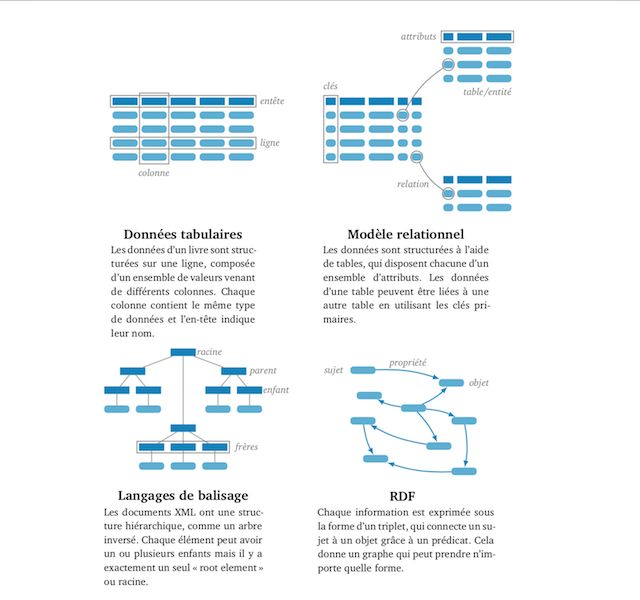
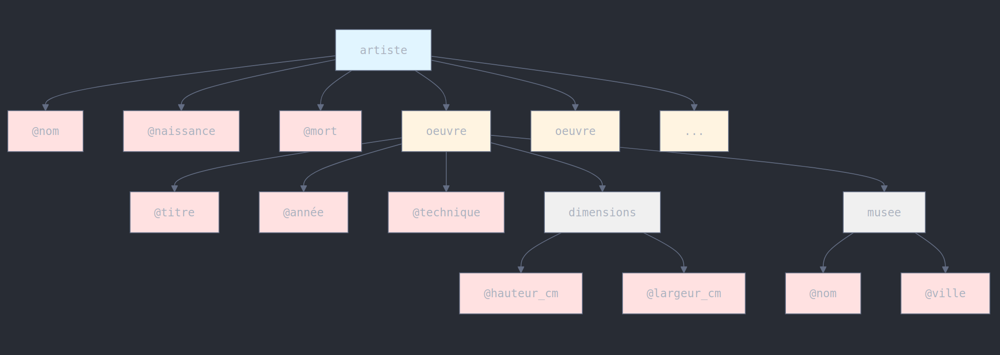
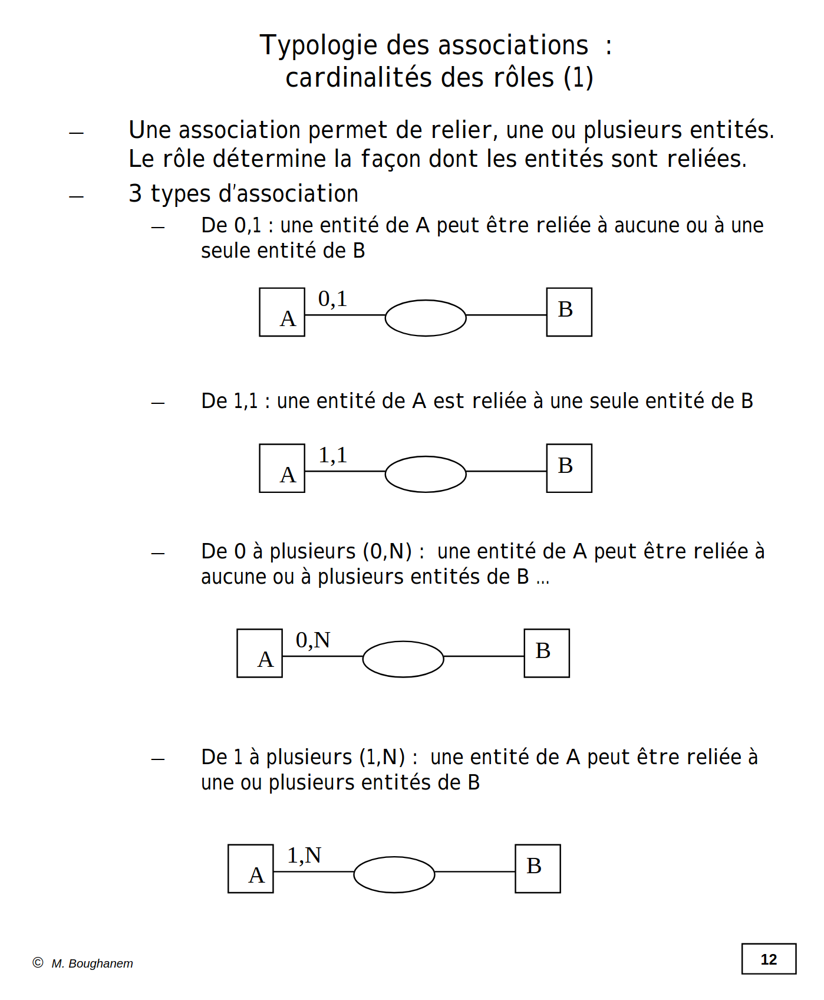
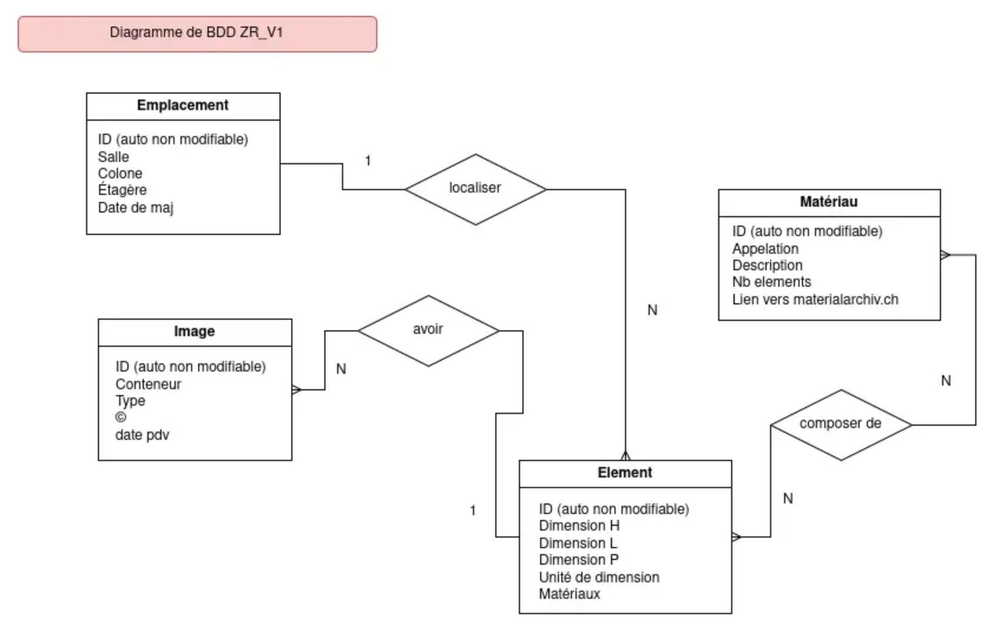

<style display="none">
.flex-1 {
  flex: 1;
}
.flex-1-5 {
  flex: 1.5;
}
#ouvroir {
  position: relative;
  right: 10%;
}
#cieco {
  max-width: 50%;
  position: relative;
  left: 5%;
}
#udem {
  margin-top: 0;
  position: relative;
  bottom: 15%;
}
.reveal h3 {
  margin-top: 1em;  
  }
.reveal .logos {
  margin-top: 2em;
}
</style>

# Inventaire et traitement des données

### MSL6517 – automne 2026

Zoë Renaudie

https://studium.umontreal.ca/course/view.php?id=351279

/** Notes **/
Contenu vient en partie du cours d'Emmanuel Château-Dutier

===vvvvvv===

<!-- .slide: class="text-small" -->
| Semaine  | Séance      | Thème                                                        | TP rendu                    |
| -------- | ----------- | ------------------------------------------------------------ | --------------------------- |
|          |             | ~~Introduction~~                                             | ~~Présentation → 14 sept.~~ |
| 14 sept. | S1          | ~~Présentation générale des enjeux numériques dans les musées~~ | ~~TP1 → 21 sept.~~          |
| 21 sept. | S2          | ~~La documentation muséale~~                                 | ~~TP2 → 28 sept.~~          |
| 28 sept. | S3          | ~~La gestion de collection : inventaire, normes, modèles métiers~~ | ~~TP3 → 05 oct.~~               |
| 05 oct.  | S4 (async.) | ~~Les interfaces publiques et catalogues en ligne~~              | ~~TP4 → 12 oct.~~               |
| 12 oct.  | S5 (async.) | ~~La notion de métadonnées~~                                     | ~~TP5 → 26 oct.­­~~               |
| 19 oct.  |             | ~~Semaine de lecture~~                                       |                             |
| 26 oct.  | S6          | ~~Données structurées, langages documentaires et thesaurus~~     | ~~TP6 → 02 nov.~~               |
| 02 nov.  | S7          | ~~Open GLAM : Open data et Open Content~~                        | ~~TP7 → 09 nov.~~              |
| 09 nov.  | S8          | Modélisation de données                                      | TP8 → 16 nov.               |
| 16 nov.  | S9          | Le modèle relationnel                                        | TP9 → 23 nov.               |
| 23 nov.  | S10         | Les ontologies dans le domaine patrimonial                   | TP10 → 30 nov.              |
| 30 nov.  | S11         | Éthique des données et pérennisation                         |                             |
| 07 déc.  | S12         | L'intelligence artificielle et les enjeux du traitement des données |                             |
| 21 déc.  |             | **Rendu du travail final**                                   |                             |


/** Notes **/

Rappels sur les séances précédentes

- les contextes métiers
- les modèles de métadonnées

Produire une description des objets culturels suppose de pouvoir distinguer des catégories d’informations pertinentes pour rendre compte de l’objet décrit. Le CIDOC a par exemple définit dès les années 90 une listes minimales de catégories d’information pour la description des objets culturels. On a également vu que la norme Spectrum identifiait pour chaque procédure un certain nombre d’informations à renseigner. D’autres normes métiers comme les CDWA du Getty, ou InfoMuse, listent des catégories d’information à destination des professionnels de musées.

Ces normes constituent des modèles conceptuels qui vont devoir recevoir une traduction dans des formats informatiques pour que l’information puisse être gérée de manière informatique. Nous allons maintenant aborder des questions propres à l’informatique (informatique de information et automatique) et ses applications en sciences de l’information et de la documentation.

Ce chapitre aura donc un caractère relativement plus marqué que les autres. [Ce dont vous avez déjà pu vous apercevoir avec la lecture de cette semaine.] Les questions méthodologiques et opérationnelles liées à la recherche d’information et à la structuration des données ne sont pas nécessairement toujours familières aux professionnels des musées. Il s’agit ici d’aborder des questions relatives à la production d’un langage documentaire, aux recherches avancées dans un système d’information et à la création d’un schéma de base de données. Ces sujets font parfois fuire les étudiantes et les étudiants en sciences humaines et sociales. Toutefois il s’agit ici d’un enjeu de littératie numérique.

En dépit du temps passé sur les réseaux sociaux qui laisse souvent croire que les étudiants seraient des digital natives, ceux-ci son souvent incapables d’ouvrir la boîte noire du web et d’appréhenser son fonctionnement. Il en est de même des grands systèmes d’information et de leur structuration en bases de données relationnelles.

Aujourd’hui, nous allons donc parler d’informatique documentaire appliquée au monde muséal et patrimonial. C'est un domaine qui combine la gestion de l'information, les technologies numériques et la documentation du patrimoine culturel.

Question : Quand vous entendez “informatique documentaire”, qu’est-ce que ça vous évoque ? 

Des catalogues ? Des bases de données ? Des métadonnées ? 

Ex Outils utilisés :
Logiciels de gestion de collections (comme TMS, Vernon, CollectiveAccess)
Bases de données relationnelles
Systèmes de gestion documentaire
Normes de catalogage (SPECTRUM, CIDOC, Dublin Core)

Ex Applications concrètes :
Numérisation des collections (photographies, scans 3D)
Création de catalogues en ligne accessibles au public
Gestion des prêts entre institutions
Suivi de la conservation préventive
Documentation des expositions
Création d'archives numériques du patrimoine

Vous avez raison : ce sont des outils, mais c’est aussi une manière d’organiser l’information pour pouvoir la chercher, la gérer et la partager.

L’objectif premier de ce cours sera de vous aider à comprendre et à maîtriser les technologies de l’information afin d’en tirer le meilleur parti dans votre futur parcours professionnel et scientifique. Dans nos métiers, nous en avons tous besoin. Pourtant, ce n’est pas toujours évident d’entrer dans ces logiques techniques. Donc essayons justement de dédramatiser l'informatique et de vous donner des bases solides.

===vvvvvv===

## Modéliser les données

/** Notes **/

===vvvvvv===


[Uniformed Letter Carrier with Child in Mailbag, Smithsonian Institution](https://www.flickr.com/photos/smithsonian/2584174182)


/** Notes **/

Lors de sa conférence à l’Université de Montréal, Seth Van Hooland a présenté cette image saisissante d’un facteur américain posant avec un jeune garçon… dans son sac postal. Après l’introduction du service postal pour colis en 1913, au moins deux enfants ont été envoyés par ce service, avec des timbres attachés à leurs vêtements, voyageant avec des facteurs ferroviaires ou urbains jusqu’à leur destination. À la suite de ces incidents, le Postmaster General a rapidement émis un règlement interdisant d’envoyer des enfants par courrier. [Source : Smithsonian, 1913](https://www.flickr.com/photos/smithsonian/2584174182).

Cette photographie illustre bien la manière dont un système — ici le courrier postal — structure et contraint les pratiques : l’introduction d’une norme nouvelle (l’envoi de colis) entraîne des expérimentations extrêmes, rapidement corrigées par la réglementation. De manière analogue, les modèles de données et les standards informatiques  façonnent la façon dont nous documentons, recherchons et interprétons l’information. Les outils numériques imposent une certaine vision du monde, définissent ce qui peut être représenté et ce qui reste invisible.

Pour les chercheurs en sciences humaines, qui entretiennent parfois une relation complexe ou distante avec l’informatique, cela signifie que travailler avec des modèles documentaires n’est pas qu’une question technique : c’est aussi réfléchir aux implications de ces modèles sur la connaissance que nous produisons et partageons. Les « content providers » et « service providers » nous imposent souvent des standards ou des outils, mais il est possible, et souhaitable, de développer une relation plus équilibrée avec ces technologies, en comprenant les logiques qu’elles incarnent et en choisissant consciemment comment les appliquer.

Comme le rappellent Van Hooland et al. dans leur rapport sur les « low-hanging fruits of linked data » ([Dublin Core Webinar, 2014](https://www.dublincore.org/webinars/2014/how_to_pick_the_low_hanging_fruits_of_linked_data/slides.pdf)), toute application informatique repose sur une vision explicite et délimitée du monde. Les modèles de données sont justement ces instruments qui permettent de formaliser, de communiquer et de rendre explicite le contenu des documents. De la bibliothèque d’Alexandrie au IIIe siècle avant notre ère jusqu’aux données ouvertes publiées par le gouvernement canadien sur [ouvert.canada.ca](http://ouvert.canada.ca), les humains ont systématiquement cherché à rendre l’information intelligible et partageable, en construisant des modèles qui donnent sens au chaos documentaire.

Ainsi, cette image d’un enfant dans un sac postal nous rappelle, de façon frappante et presque humoristique, que les systèmes que nous utilisons (qu’ils soient postaux ou informatiques) façonnent nos pratiques, nos recherches et, in fine, notre compréhension du monde.

Des modèles de données différents ont été développés au cours du temps afin de pouvoir structurer les caractéristiques de documents (van Hooland and Verborgh, 2014). Ces modèles consiste en quelque sorte en des manières de représenter la réalité. Ils permettent de cerner un ensemble limité de caractéristiques d’une réalité du monde empirique. 

===vvvvvv===

## Qu'avez vous observé dans votre choix de base de données ? 

/** Notes **/

Savez-vous quel modèle a été appliqué ? 

Pourquoi c'est important de savoir ? 

===vvvvvv===

## Définitions

### Bases de données

> Ensemble structuré d’éléments d’**informations** souvent agencés sous forme de **tables**, dans lesquelles les **données** sont organisées selon certains critères en vue de permettre leur exploitation pour répondre aux besoins d’information d’une organisation (*Database*). 

Gilles Roy. 2007. *Conception de bases de données avec UML*. Québec : Presses de l’Université du Québec.

/** Notes **/

Avant d’entrer dans le détail du modèle relationnel, il est nécessaire de clarifier quelques notions fondamentales :

🔹 Base de données

Une base de données est un ensemble structuré d’informations, organisé pour être facilement consulté, mis à jour et partagé.
Dans un musée, cela correspond par exemple à la base des collections, qui rassemble toutes les fiches d’œuvres, les informations sur les artistes, les expositions ou les mouvements d’objets.

Une base de données permet de stocker et d’accéder à des données structurées, semi-structurées ou des données brutes en rapport avec un domaine d’activité. Il existe plusieurs types de bases de données. À partir des années 80, le modèle relationnel et langages de manipulation et de requête de données SQL se sont largement imposés, mais depuis le milieu des années 2000, des modèles de bases de données orientés document (dites NoSQL) ont également fait leur apparition.

Une base de données n’est pas seulement un “conteneur” : elle repose sur une structure logique, souvent définie selon un modèle conceptuel (relationnel, hiérarchique, orienté document, etc.).

===vvvvvv===

## Définitions
### Système de gestion de bases de données (SGBD)

> Logiciel, le plus souvent produit par un éditeur commercial, qui gère et contrôle l’accès à une base de données, assurant ainsi une interface normalisée entre les applications et les bases de données (*Database management system*).

### Application de base de données

> Utilisation de moyens informatique pour répondre à un besoin déterminé en faisant appel à une ou plusieurs bases de données à travers un SGBD Système de gestion de base de données.

/** Notes **/

🔹 Système de gestion de base de données (SGBD)

Le SGBD est le logiciel qui permet de créer, de manipuler et de gérer une base de données.
Il assure l’accès simultané des utilisateurs, la sécurité des données, la cohérence des mises à jour et la sauvegarde des informations.

Parmi les SGBD les plus répandus dans le domaine patrimonial :

MySQL, PostgreSQL ou Microsoft SQL Server pour les systèmes relationnels ;

FileMaker Pro (Claris) dans de nombreux musées d’art et centres d’archives ;

CollectiveAccess ou MuseumPlus, qui utilisent un SGBD relationnel pour gérer les métadonnées muséales.

🔹 Application de base de données

Une application de base de données correspond à l’interface développée pour un usage spécifique : recherche, saisie, gestion de prêts, statistiques, etc.
C’est l’environnement dans lequel les utilisateurs interagissent avec les données.
Par exemple, une interface de documentation d’exposition dans CollectiveAccess est une application reposant sur une base relationnelle.

Gilles Roy. 2007. *Conception de bases de données avec UML*. Québec : Presses de l’Université du Québec.

===vvvvvv===



/** Notes **/

Pour organiser les données, il existe 4 grands modèles:

Tabulaire : simple tableau CSV, intuitif mais fragile.

Relationnel : tables liées, très efficace pour gérer des données complexes.

XML/JSON : structure hiérarchique en arbre.

RDF : graphe de triplets, au cœur du web sémantique.

Imaginez qu’il s’agisse de quatre paires de lunettes différentes pour regarder vos données.

Qu'observez vous en comparant les illustrations des modèles ? 

Dans les quatre cas, les données ne « parlent » d'elles-mêmes que grâce à un schéma : l'en-tête des colonnes pour un CSV, la définition des tables et de leurs relations pour le relationnel, la DTD ou le XML Schema pour XML, les vocabulaires et ontologies pour RDF.

===vvvvvv===

## Qu'est-ce qu'un schéma ?

Un schéma est la description formelle de la structure des données :
quelles entités (objets, artistes, lieux…), quels attributs (titre, date, matériaux…),
quelles relations entre elles, et quelles règles (types, contraintes, vocabulaires autorisés).

Il peut être implicite (l'en-tête d'un CSV) ou explicite (un XML Schema, un modèle entité-relation)

Il existe à plusieurs niveaux : conceptuel → logique → physique

/** Notes **/

Définition simple : un schéma décrit comment sont structurées les données, indépendamment des données elles-mêmes. Le schéma, c'est la règle du jeu ; les données, c'est la partie jouée.

Exemples :

Le schéma du tableau Excel, c'est la ligne d'en-tête : « Numéro, Objet, Artiste, Titre, Date ». Si deux collègues utilisent des en-têtes différents, les données ne peuvent pas être combinées.

Le schéma d'une base relationnelle, ce sont les tables, leurs colonnes, leurs clés mais surtout leurs relations (on le représente par un diagramme entité-relation).

Le schéma d'un document XML, c'est ce qui dit quelles balises existent et dans quel ordre (DTD, XML Schema, Relax NG).

Le schéma en RDF, ce sont les vocabulaires et ontologies (Dublin Core, SKOS, CIDOC-CRM) qui définissent les propriétés utilisables.

Nous en parlerons plus précisément la semaine prochaine mais il y a trois niveaux :

Conceptuel : ce qu'on veut décrire et pourquoi (les catégories d'information du CIDOC, de Spectrum, des CDWA) Aucune technique.
Logique : comment on structure l'information dans un modèle de données (tables, arbre, graphe).
Physique : comment c'est implémenté dans un logiciel (SQL Server, PostgreSQL, une API JSON, un triplestore).

===vvvvvv===
## Les données tabulaires


/** Notes **/

Le modèle le plus intuitif est probablement celui du tableau : colonne, entête et ligne.

Dans le modèle de données tabulaires, les données sur un objet sont structurées sur une ligne, composée d’un ensemble de valeurs renseignées dans différentes colonnes. Chaque colonne contient un même type de données et l’en-tête indique leur nom.

Question :
Quel a été votre expérience avec un fichier Excel pour cataloguer des objets ou des œuvres ? Quels problèmes avez-vous rencontrés ? Quelles sont les limites d’un tel modèle ?

doublons, incohérences, colonnes trop longues

- il impose la répétition des descripteurs : il faut faire très attention aux erreurs de frappes lors de la saisie des informations pourqu'elles correspondent. 
- Il n’y a aucune abstraction, chaque nouvelle ligne doit donner lieu à un nouvel encodage. 
- Il n’y a pas de prise sur la cohérence des données.
- photo et image  alors que c'est une source d'identification très utile.
- La visualisation en tableau n'est pas simple lorsqu'on dépasse un certain nombre de colonne. 
- Le système de filtre par colonne est très pratique, il permet de trier les lignes et de filtrer les informations dans les lignes. Cependant si on décide de faire une ligne par objet on rencontre un problème s'il y a plusieurs informations dans la case. Par exemple, plusieurs auteurs, plusieurs emplacements, etc pour un même objet. Dans tous les cas, il ne faut pas oublier de mettre des filtres à toutes les colonnes pour le tri sinon les informations se mélangent.

Bref, c’est exactement pour ça qu’on a inventé les bases relationnelles, puis XML, puis RDF.

===vvvvvv===

## Exemples

- Formats Excel, Calc, CSV, TSV etc.

```csv
Numéro,Objet,Artiste,Titre,Date
CE.1934.01,Pelle,Inconnu,Pelle commémorative,1908
CE.1934.05,Estampe,"Inconnu, d'après Charles Huot",Le 
Père Jean-Baptiste Godbout. Photographie d'un tableau 
de Charles Huot,avant 1928
```

| Numéro     | Objet   | Artiste                       | Titre                                                        | Date       |
| ---------- | ------- | ----------------------------- | ------------------------------------------------------------ | ---------- |
| CE.1934.01 | Pelle   | Inconnu                       | Pelle commémorative                                          | 1908       |
| CE.1934.05 | Estampe | Inconnu, d'après Charles Huot | Le Père Jean-Baptiste Godbout. Photographie d'un tableau de Charles Huot | avant 1928 |

/** Notes **/
Comma-separated values
CSV est un format texte ouvert pour représenter des données tabulaires séparées par des virgules. Il est utilisé pour échanger des données entre logiciel

===vvvvvv===
### Tabulaire

| Titre                 | Artiste      | Année | Musée             | Technique       | Hauteur_cm | Largeur_cm |
| --------------------- | ------------ | ----- | ----------------- | --------------- | ---------- | ---------- |
| Le Marché aux chevaux | Rosa Bonheur | 1853  | Musée d'Orsay     | Huile sur toile | 248        | 506        |
| Labourage nivernais   | Rosa Bonheur | 1849  | Musée d'Orsay     | Huile sur toile | 135        | 260        |
| Chevaux au paddock    | Rosa Bonheur | 1850  | Collection privée | Huile sur toile | 130        | 240        |

/** Notes **/

* **Avantages** : simple, facile à lire et importer dans Excel.
* **Limites** : difficile de représenter des relations complexes ou multiples (ex. expositions, copies, bibliographie).

===vvvvvv===

## Les données relationnelles


/** Notes **/

Dans les années 1970, on a assisté à une migration vers les bases de données relationnelles, qui apportaient un niveau d’abstraction beaucoup plus élevé que les simples tableurs.

Dans ce modèle, les données sont organisées en tables, chacune comportant un ensemble d’attributs. Les informations d’une table peuvent être reliées à celles d’une autre grâce à des clés primaires et des relations. Cela permet de modéliser des entités distinctes, indépendantes les unes des autres, mais reliées entre elles de manière cohérente.

Ce modèle est aujourd’hui dominant dans l’informatique et restera probablement central pendant encore longtemps. Il est très puissant opérationnellement, car il permet de gérer de grandes quantités de données de manière structurée et cohérente.

Cependant, il présente aussi certaines limites. Les bases relationnelles sont peu flexibles face au changement : lorsque le monde empirique évolue, il faut adapter le schéma, modifier les tables et les relations, ce qui peut être complexe et laborieux.

De plus, dans le contexte du web, le partage de données peut être problématique. Les fichiers relationnels sont souvent binaires et ne peuvent pas être partagés aussi facilement que du texte. Pour que les données soient partageables, il faut ajouter une couche sémantique, comprendre le modèle et adapter les formats, ce qui rend l’échange moins direct.

Le modèle relationnel est extrêmement robuste et structurant, mais il peut se montrer rigide face aux évolutions et aux besoins de partage dans des environnements distribués comme le web.

===vvvvvv===

<!-- .slide: class="text-small" -->
### Relationnel (tables liées)

**Table : Œuvre**

| ID | Artiste_ID | Titre                 | Année | Technique       | Hauteur_cm | Largeur_cm | Musée_ID |
| -- | -- |--------------------- | ----- | --------------- | ---------- | ---------- | -------- |
| 1  | 1 |Le Marché aux chevaux | 1853  | Huile sur toile | 248        | 506        | 1        |
| 2  | 1 |Labourage nivernais   | 1849  | Huile sur toile | 135        | 260        | 1        |
| 3  | 1 |Chevaux au paddock    | 1850  | Huile sur toile | 130        | 240        | 2        |

**Table : Artiste**

| ID | Nom          | Naissance | Mort |
| -- | ------------ | --------- | ---- |
| 1  | Rosa Bonheur | 1822      | 1899 |

**Table : Musée**

| ID | Nom               | Ville         |
| -- | ----------------- | ------------- |
| 1  | Musée d'Orsay     | Paris         |
| 2  | Collection privée | Non spécifiée |

/** Notes **/

* **Avantages** : relation entre tables, gestion de données complexes et multiples œuvres/artistes/musées.
* **Limites** : rigidité des schémas, pas idéal pour les données très hiérarchiques ou liées à des graphes web.

===vvvvvv===

## Les données hiérarchiques


/** Notes **/

Vers l’an 2000, un troisième modèle de données est apparu avec l’essor de XML. Il s’agit d’un modèle conceptuel en arbre, entièrement structuré autour de la notion de hiérarchie.

Les documents XML utilisent des langages de balisage : chaque élément peut contenir un ou plusieurs enfants, mais il n’existe qu’un élément racine unique, appelé root element. Cette organisation en arbre permet de représenter clairement les relations entre les données, un peu comme un arbre inversé où toutes les branches dépendent d’un tronc unique.

Comme XML est un format entièrement textuel, il a résolu une partie du problème de l’interopérabilité technique : les fichiers peuvent être lus et échangés entre systèmes différents sans dépendre d’un logiciel particulier.

Cependant, l’interopérabilité sémantique reste un défi. Pour que les données soient comprises et utilisées correctement par d’autres, il faut se référer à un schéma et prendre le temps de comprendre la vision de celui qui a produit le document. Autrement dit, XML facilite l’échange technique des données, mais la compréhension exacte de leur sens nécessite un effort supplémentaire.

===vvvvvv===

## Exemples

- Bibliothèques : [MARC XML](https://www.loc.gov/standards/marcxml/) 
- Archivistique : [XML-EAD](https://www.loc.gov/ead/), [XML-EAC-CPF](https://eac.staatsbibliothek-berlin.de/)
- Edition numérique : [XML TEI](https://tei-c.org/guidelines/p5/), [XML Érudit](http://www.erudit.org/xsd/article/2.0.0/doc/), [JATS](https://jats.nlm.nih.gov/)
- Musées : [LIDO](http://cidoc.mini.icom.museum/fr/groupes-travail/lido/what-is-lido/)
- Thésaurus : [SKOS]((https://www.w3.org/2004/02/skos/)

/** Notes **/

Dans le domaine culturel et scientifique, de nombreux standards utilisent **XML** pour structurer et échanger des données :

* **Bibliothèques** : [MARC XML](https://www.loc.gov/standards/marcxml/)
* **Archivistique** : [XML-EAD](https://www.loc.gov/ead/), [XML-EAC-CPF](https://eac.staatsbibliothek-berlin.de/)
* **Édition numérique** : [XML TEI](https://tei-c.org/guidelines/p5/), [XML Érudit](http://www.erudit.org/xsd/article/2.0.0/doc/), [JATS](https://jats.nlm.nih.gov/)
* **Musées** : [LIDO](http://cidoc.mini.icom.museum/fr/groupes-travail/lido/what-is-lido/)
* **Thésaurus** : [SKOS](https://www.w3.org/2004/02/skos/)

En 2001, la **Bibliothèque du Congrès** a développé un ensemble d’outils pour permettre l’utilisation des données structurées en format MARC dans un environnement XML, facilitant ainsi l’échange et la standardisation des métadonnées bibliographiques.

D’un autre côté, **JSON** (*JavaScript Object Notation*) est apparu comme un **format d’échange de données léger**. Il est **facile à lire et à écrire pour les humains**, et tout aussi facile à analyser et générer pour les machines. JSON est principalement utilisé pour **transmettre des données entre un serveur et une application web** sous forme de texte, ce qui le rend particulièrement adapté aux environnements web modernes.

En résumé, XML et JSON servent tous deux à structurer et partager les données, mais XML est plus **verbeux et orienté documents complexes**, tandis que JSON est plus **léger et orienté applications web**.


===vvvvvv===

XML (hiérarchie en arbre)

```xml
<artiste nom="Rosa Bonheur" naissance="1822" mort="1899">
  <oeuvre titre="Le Marché aux chevaux" année="1853" 
          technique="Huile sur toile">
    <dimensions hauteur_cm="248" largeur_cm="506"/>
    <musee nom="Musée d'Orsay" ville="Paris"/>
  </oeuvre>
  <oeuvre titre="Labourage nivernais" année="1849" 
          technique="Huile sur toile">
    <dimensions hauteur_cm="135" largeur_cm="260"/>
    <musee nom="Musée d'Orsay" ville="Paris"/>
  </oeuvre>
  <oeuvre titre="Chevaux au paddock" année="1850" 
          technique="Huile sur toile">
    <dimensions hauteur_cm="130" largeur_cm="240"/>
    <musee nom="Collection privée" ville="Non spécifiée"/>
  </oeuvre>
</artiste>
```

/** Notes **/

* **Avantages** : structure flexible, idéale pour documents hiérarchiques.
* **Limites** : moins efficace pour requêtes complexes ou pour connecter des données provenant de sources multiples.

===vvvvvv===

## JSON [vs] XML

```xml
<oeuvre>
  <titre>Le Marché aux chevaux</titre>
  <artiste>Rosa Bonheur</artiste>
  <technique>Huile sur toile</technique>
  <dimensions>
    <hauteur_cm>248</hauteur_cm>
    <largeur_cm>506</largeur_cm>
  </dimensions>
</oeuvre>
```
```json
{
  "titre": "Le Marché aux chevaux",
  "artiste": "Rosa Bonheur",
  "technique": "Huile sur toile",
  "dimensions": {
    "hauteur_cm": 248,
    "largeur_cm": 506
  }
}
```

/** Notes **/

Prenons l’exemple de l’œuvre Le Marché aux chevaux de Rosa Bonheur. Ces deux documents décrivent le même objet.

En XML, les données sont organisées avec des balises hiérarchiques : chaque élément a un nom, et les sous-éléments sont imbriqués. Ici, <oeuvre> est la racine, avec <titre>, <artiste>, <annee>, <musee>, <technique>, et <dimensions> contenant hauteur_cm et largeur_cm. XML est très verbeux, mais il est très adapté pour les documents complexes, pour les standards de bibliothèques et musées, et pour ceux qui ont besoin de contrôler strictement le schéma des données.

En JSON, la même information est représentée sous forme d’objets et de sous-objets. Les noms des champs remplacent les balises, et les valeurs sont directement associées à ces clés. JSON est plus compact, plus facile à lire et à écrire, et particulièrement adapté au web et aux API, car il est léger et facilement analysable par les applications.

En résumé :

XML → plus verbeux, très structuré, idéal pour des documents normés et hiérarchiques.

JSON → plus léger, simple à manipuler, idéal pour le web et les échanges rapides de données.

Ce comparatif montre comment le même contenu peut être structuré différemment selon les besoins et le contexte d’utilisation.

===vvvvvv===
## Modèles en graphe (RDF)


/** Notes **/

Le modèle en graphe, notamment incarné par RDF (Resource Description Framework), représente une évolution majeure par rapport aux modèles relationnels ou hiérarchiques. Il cherche à dépasser les barrières sémantiques en adoptant une approche très simple : chaque information est exprimée sous la forme d’un triplet, reliant un sujet à un objet via un prédicat. Ces triplets forment un graphe, dont la structure peut être libre et prendre n’importe quelle forme.

Dans RDF, l’ensemble des informations est décrit à l’aide d’assertions et opérationnalisé grâce à des URL ou IRI, ce qui rend le modèle particulièrement puissant pour le partage et l’échange de données à l’échelle du web.

### Avantages pour les musées

RDF présente plusieurs atouts pour le secteur muséal :

Interconnexion : une même ressource, par exemple un artiste, peut être le sujet d’un triplet et l’objet d’un autre, créant un réseau dense de relations.

Extensibilité : il est toujours possible d’ajouter de nouveaux triplets sans modifier la structure existante.

Interopérabilité : différents musées peuvent lier leurs graphes entre eux si leurs ressources utilisent des identifiants communs (URIs), facilitant ainsi la création de réseaux de données partagés.

### Limites et précautions

Malgré ses promesses, RDF présente également des limites importantes :

Il permet à n’importe qui de déclarer n’importe quoi, ce qui peut poser des problèmes de qualité et de fiabilité des informations.

Dans la pratique, RDF n’est pas toujours applicable à tous les types de données et peut être complexe à mettre en œuvre.

Le modèle nécessite une réflexion préalable sur les objectifs et sur la façon dont les données seront exploitées, car un graphe mal conçu peut rapidement devenir difficile à gérer.

En résumé, RDF offre un potentiel immense pour l’échange et l’interconnexion des données, mais il reste crucial de rester critique et de définir clairement ses objectifs avant de l’adopter.

===vvvvvv===
## Resource Description Framework [RDF]


<https://www.w3.org/TR/rdf11-primer/>

/** Notes **/

## Assertions simples

Le triplet sujet → prédicat → objet est l'unité de base de RDF. Par exemple :

La Joconde → a été créée par → Léonard de Vinci
Le Musée du Louvre → est situé à → Paris
Cette sculpture → date de → 1889

Le graphe de connaissances
Cette structure simple permet de construire progressivement un graphe de connaissances où :

Les nœuds représentent les ressources (œuvres, artistes, lieux, dates, concepts...)
Les arcs orientés représentent les relations entre ces ressources
Chaque arc pointe du sujet vers l'objet


===vvvvvv===

### **RDF (triplets, graphe sémantique)**

URI_Obj_1   --->   a pour titre     --->     "Le Marché aux chevaux"   
URI_Obj_1   --->   est            --->        oeuvre   
URI_Obj_1   --->   a pour créateur    --->    Rosa_Bonheur           
Rosa_Bonheur --->   est née  --->              1822                    
Rosa_Bonheur --->  est décédée   --->         1899                    
URI_Obj_1  --->   a pour technique   ---> "Huile sur toile"       
URI_Obj_1   --->  a pour hauteur (cm)    ---> 248                                       
URI_Obj_1   --->  est localisé à  --->  Musée_d'Orsay           

/** Notes **/
* **Avantages** : très puissant pour relier des ressources, interroger le web sémantique, créer des inférences.
* **Limites** : moins intuitif pour une lecture humaine directe.

===vvvvvv===
```rdf
@prefix ex: <http://notreexample.org/musee#> .
@prefix dbo: <http://dbpedia.org/ontology/> .
@prefix dcterms: <http://purl.org/dc/terms/> .
@prefix xsd: <http://www.w3.org/2001/XMLSchema#> .
@prefix foaf: <http://xmlns.com/foaf/spec/> .

# Artiste
ex:RosaBonheur a dbo:Artist ;
    dbo:birthDate "1822"^^xsd:gYear ;
    dbo:deathDate "1899"^^xsd:gYear ;
    foaf:name "Rosa Bonheur" ;
    dbo:knownFor ex:LeMarcheAuxChevaux, ex:LabourageNivernais, ex:ChevauxAuPaddock .

# Œuvres
ex:LeMarcheAuxChevaux a dbo:Artwork ;
    dcterms:title "Le Marché aux chevaux" ;
    dcterms:created "1853"^^xsd:gYear ;
    dbo:artist ex:RosaBonheur ;
    dbo:material "Huile sur toile" ;
    dbo:height "248"^^xsd:decimal ;
    dbo:width "506"^^xsd:decimal ;
    dbo:museum ex:MuseeOrsay .

# Musées
ex:MuseeOrsay a dbo:Museum ;
    foaf:name "Musée d'Orsay" ;
    dbo:location "Paris" .

```
/** Notes **/
En réalité on structure nos données grace au langage turtle notamment. 

Comment lire ça ?

## Les préfixes en Turtle

Dans Turtle, on travaille souvent avec des **URI** (identifiants uniques pour chaque ressource) qui sont généralement très longues, par exemple :

```
http://dbpedia.org/ontology/Artist
```

Pour **simplifier l’écriture**, Turtle permet de définir des **préfixes**, qui sont des **raccourcis pour ces URI longues**.

### Exemple :

```turtle
@prefix dbo: <http://dbpedia.org/ontology/> .
@prefix ex: <http://example.org/musee#> .
```

* `dbo:` devient un raccourci pour `http://dbpedia.org/ontology/`
* `ex:` devient un raccourci pour `http://example.org/musee#`

Ainsi, au lieu d’écrire l’URI complète, on peut simplement écrire :

```turtle
ex:RosaBonheur a dbo:Artist .
```

Ce qui est équivalent à :

```
http://example.org/musee#RosaBonheur a http://dbpedia.org/ontology/Artist .
```

### Pourquoi c’est pratique ?

1. **Lisible** : les noms sont plus courts et plus compréhensibles.
2. **Moins d’erreurs** : on évite de recopier de longues URL.
3. **Flexible** : on peut changer la base URI dans le préfixe sans toucher à tous les triplets.

En résumé, les **préfixes sont des raccourcis** qui rendent Turtle plus lisible et plus facile à écrire, tout en conservant la précision des URI pour le web sémantique.


La première ligne ex:RosaBonheur a dbo:Artist ; dit que Rosa Bonheur est un artiste.

Les lignes suivantes ajoutent des informations sur elle : son nom, sa date de naissance et de décès, et les œuvres qu’elle a créées.

La partie ex:LeMarcheAuxChevaux décrit l’œuvre elle-même : titre, artiste, technique, dimensions, musée.

Pourquoi c’est utile ?

Cela relie toutes les informations entre elles, créant un graphe que l’on peut interroger ou explorer.

C’est flexible : on peut ajouter de nouvelles informations sans toucher à l’existant.

C’est compatible avec le web sémantique, donc d’autres institutions ou bases de données peuvent relier leurs données facilement.

===vvvvvv===

<!-- .slide: class="text-small" -->
## Synthèse

| modèle de données  | (dés-)avantages                                              | contexte                                                     |
| ------------------ | ------------------------------------------------------------ | ------------------------------------------------------------ |
| données tabulaires | + approche intuitive + portable + indépendance technique – sujet à la redondance et entraîne des incohérences – recherches lentes et inefficaces | import et export de données ayant une structuration simple   |
| modèle relationnel | + gestion de données complexes + optimalisation des requêtes + logiciels matures – format binaire								– dépendance d’un schéma | gestion de données complexes dans un contextelocal           |
| XML                | + interopérabilité technique + lisible à la fois par l’humain et par la machine – implémentation complexe pour des données complexes – verbeux | import et export de données complexes et la gestion de données avec une structure hiérarchique |
| RDF                | + neutralité du schéma + découverte d’information du monde ouvert – perte de la normalisation – marché de logiciels immature | partage de données sur le Web                                |

===vvvvvv===

## Questions qui président au choix de modélisation

- Quelle est la base conceptuelle du modèle ?
- Comment peut-on l’implémenter sur le terrain à l’aide de logiciels ?
- Quel est l’impact du modèle sur la manière dont on peut gérer les données ?
- Comment peut-on lancer des requêtes ?
- Quelles sont les possibilités de partage des données ?
- Comment les données peuvent-elles évoluer dans le temps ?

/** Notes **/

Pour chacun de ces modèles, je vous rappelle les six questions distinctes qui vous permettront de comprendre le fonctionnement précis de chacun des modèles et leur implémentation dans un système d’information :

- Quelle est la base conceptuelle du modèle ?
- Comment peut-on l’implémenter sur le terrain à l’aide de logiciels ?
- Quel est l’impact du modèle sur la manière dont on peut gérer les données ?
- Comment peut-on lancer des requêtes ?
- Quelles sont les possibilités de partage des données ?
- Comment les données peuvent-elles évoluer dans le temps ?

**6 questions qui structurent l’analyse des avantages et désavantages de chaque modèle**.

===vvvvvv===
### Conclusion 

/** Notes **/
Les modèles de données (table, base relationnelle, XML, RDF) sont des outils différents qui reflètent différentes manières de représenter le monde. Tous les outils ont besoin d'un schéma pour être compris. Mêmes les excels doivent avoir les mêmes noms de colonnes.  

Comprendre ces outils, c’est développer une littératie numérique indispensable pour travailler dans les musées et le patrimoine.

Question ouverte :
Quel modèle ou quel outil vous semble le plus utile dans vos pratiques actuelles ou futures ?

conclure sur l’importance d’adapter l’outil au besoin. Il existe des formations dans chaque domaine. 

===vvvvvv===
# Le modèle relationnel en contexte muséal

/** Notes **/

Les institutions muséales produisent, conservent et diffusent une quantité considérable d’informations : sur les œuvres, les artistes, les expositions, les prêts, les lieux, les événements, les partenaires, etc.
Ces informations sont au cœur de la mission patrimoniale et scientifique du musée. Mais elles proviennent de sources variées, circulent entre de multiples acteurs et changent de forme au fil du temps.

Vous l'aurez compris, la modélisation des données consiste à organiser cette complexité de manière structurée.
Elle permet de représenter les éléments du monde réel (objets, personnes, événements) sous la forme de données cohérentes et interreliées, afin qu’elles puissent être enregistrées, partagées, consultées et réutilisées dans le temps.

Dans le contexte muséal, cela signifie par exemple :

- relier une œuvre à son artiste, à son exposition, à son prêteur et à sa localisation dans les réserves ;
- documenter les multiples versions d’une installation ou d’une performance ;
- assurer la traçabilité des interventions de restauration ;
- ou encore permettre la diffusion en ligne des collections sous forme de données ouvertes.

Les bases de données sont donc devenues des outils de mémoire pour les musées : elles soutiennent à la fois la gestion quotidienne, la recherche et la valorisation publique du patrimoine.
Mais derrière ces outils, qu’il s’agisse de TMS, MuseumPlus, CollectiveAccess, FileMaker Pro ou d’un simple tableur, nous l'avons vu la semaine dernière, se cache toujours une modélisation conceptuelle : une manière de décrire la réalité à l’aide d’entités et de relations.

Comprendre cette logique est essentiel pour tout·e professionnel·le de la documentation ou de la recherche muséale. Cela permet :
- d’interpréter correctement les structures de données existantes ;
- de participer à la conception de nouveaux systèmes ;
- et de dialoguer avec les développeurs et spécialistes du numérique.

Au cours de la dernière séance, nous avons examiné quatre grands modèles conceptuels de données et commencé à envisager leur traduction dans des différents formats informatiques.

Exercice : faire un rappel des 4 modèles, traduction dans les 4 languages. 

===vvvvvv===

<!-- .slide: class="text-small" -->
### Tabulaire

<table border="1" cellpadding="6" cellspacing="0">
  <thead>
    <tr>
      <th>Titre</th>
      <th>Artiste</th>
      <th>Année</th>
      <th>Musée</th>
      <th>Technique</th>
      <th>Hauteur_cm</th>
      <th>Largeur_cm</th>
    </tr>
  </thead>
  <tbody>
    <tr>
      <td>Le Marché aux chevaux</td>
      <td>Rosa Bonheur</td>
      <td>1853</td>
      <td>Musée d'Orsay</td>
      <td>Huile sur toile</td>
      <td>248</td>
      <td>506</td>
    </tr>
    <tr>
      <td>Labourage nivernais</td>
      <td>Rosa Bonheur</td>
      <td>1849</td>
      <td>Musée d'Orsay</td>
      <td>Huile sur toile</td>
      <td>135</td>
      <td>260</td>
    </tr>
    <tr>
      <td>Chevaux au paddock</td>
      <td>Rosa Bonheur</td>
      <td>1850</td>
      <td>Collection privée</td>
      <td>Huile sur toile</td>
      <td>130</td>
      <td>240</td>
    </tr>
  </tbody>
</table>


===vvvvvv===

<!-- .slide: class="text-small" -->
### Relationnel

<table border="1" cellpadding="4" cellspacing="0">
  <caption><strong>Table : oeuvres</strong></caption>
  <thead>
    <tr>
      <th>ID</th>
      <th>Artiste_ID</th>
      <th>Titre</th>
      <th>Année</th>
      <th>Technique</th>
      <th>Hauteur_cm</th>
      <th>Largeur_cm</th>
      <th>Musée_ID</th>
    </tr>
  </thead>
  <tbody>
    <tr>
      <td>1</td>
      <td>1</td>
      <td>Le Marché aux chevaux</td>
      <td>1853</td>
      <td>Huile sur toile</td>
      <td>248</td>
      <td>506</td>
      <td>1</td>
    </tr>
    <tr>
      <td>2</td>
      <td>1</td>
      <td>Labourage nivernais</td>
      <td>1849</td>
      <td>Huile sur toile</td>
      <td>135</td>
      <td>260</td>
      <td>1</td>
    </tr>
    <tr>
      <td>3</td>
      <td>1</td>
      <td>Chevaux au paddock</td>
      <td>1850</td>
      <td>Huile sur toile</td>
      <td>130</td>
      <td>240</td>
      <td>2</td>
    </tr>
  </tbody>
</table>

<!-- Table : Artiste -->
<table border="1" cellpadding="6" cellspacing="0">
  <caption><strong>Table : Artiste</strong></caption>
  <thead>
    <tr>
      <th>ID</th>
      <th>Nom</th>
      <th>Naissance</th>
      <th>Mort</th>
    </tr>
  </thead>
  <tbody>
    <tr>
      <td>1</td>
      <td>Rosa Bonheur</td>
      <td>1822</td>
      <td>1899</td>
    </tr>
  </tbody>
</table>

<!-- Table : Musée -->
<table border="1" cellpadding="6" cellspacing="0">
  <caption><strong>Table : Musée</strong></caption>
  <thead>
    <tr>
      <th>ID</th>
      <th>Nom</th>
      <th>Ville</th>
    </tr>
  </thead>
  <tbody>
    <tr>
      <td>1</td>
      <td>Musée d'Orsay</td>
      <td>Paris</td>
    </tr> 
    <tr>
      <td>2</td>
      <td>Collection privée</td>
      <td>Non spécifiée</td>
    </tr>
  </tbody>
</table>

===vvvvvv===

### Schéma hierarchique XML



===vvvvvv===
### XML 
```xml
<artiste nom="Rosa Bonheur" naissance="1822" mort="1899">
  <oeuvre titre="Le Marché aux chevaux" année="1853" 
          technique="Huile sur toile">
    <dimensions hauteur_cm="248" largeur_cm="506"/>
    <musee nom="Musée d'Orsay" ville="Paris"/>
  </oeuvre>
  <oeuvre titre="Labourage nivernais" année="1849" 
          technique="Huile sur toile">
    <dimensions hauteur_cm="135" largeur_cm="260"/>
    <musee nom="Musée d'Orsay" ville="Paris"/>
  </oeuvre>
  <oeuvre titre="Chevaux au paddock" année="1850" 
          technique="Huile sur toile">
    <dimensions hauteur_cm="130" largeur_cm="240"/>
    <musee nom="Collection privée" ville="Non spécifiée"/>
  </oeuvre>
</artiste>
```
===vvvvvv===

### **RDF**

URI_Obj_1   --->   a pour titre     --->     "Le Marché aux chevaux"   
URI_Obj_1   --->   est            --->        oeuvre   
URI_Obj_1   --->   a pour créateur    --->    Rosa_Bonheur           
Rosa_Bonheur --->   est née  --->              1822                    
Rosa_Bonheur --->  est décédée   --->         1899                    
URI_Obj_1  --->   a pour technique   ---> "Huile sur toile"       
URI_Obj_1   --->  a pour hauteur (cm)    ---> 248                                       
URI_Obj_1   --->  est localisé à  --->  Musée_d'Orsay           

===vvvvvv===
<!-- turtle -->
```rdf
@prefix ex: <http://notreexample.org/musee#> .
@prefix dbo: <http://dbpedia.org/ontology/> .
@prefix dcterms: <http://purl.org/dc/terms/> .
@prefix xsd: <http://www.w3.org/2001/XMLSchema#> .
@prefix foaf: <http://xmlns.com/foaf/spec/> .

# Artiste
ex:RosaBonheur a dbo:Artist ;
    dbo:birthDate "1822"^^xsd:gYear ;
    dbo:deathDate "1899"^^xsd:gYear ;
    foaf:name "Rosa Bonheur" ;
    dbo:knownFor ex:LeMarcheAuxChevaux, ex:LabourageNivernais, ex:ChevauxAuPaddock .

# Œuvres
ex:LeMarcheAuxChevaux a dbo:Artwork ;
    dcterms:title "Le Marché aux chevaux" ;
    dcterms:created "1853"^^xsd:gYear ;
    dbo:artist ex:RosaBonheur ;
    dbo:material "Huile sur toile" ;
    dbo:height "248"^^xsd:decimal ;
    dbo:width "506"^^xsd:decimal ;
    dbo:museum ex:MuseeOrsay .

# Musées
ex:MuseeOrsay a dbo:Museum ;
    foaf:name "Musée d'Orsay" ;
    dbo:location "Paris" .
```

===vvvvvv===
## Le modèle relationnel d’Edgar Frank Codd

Edgard Frank Codd (1923-2003)

**Description du modèle en 1969**

*« Derivability, Redundancy, and Consistency of Relations Stored in Large Data Banks », IBM Research Report RJ599*.

**Publication scientifique en 1970**

*« A Relational Model of Data for Large Shared Data Banks" ("Un modèle de données relationnel pour de grandes banques de données partagées"), CACM 13, No. 6, June 1970*.

Algèbre relationnel, théorème de Codd (1971) et théorie des bases de données.

/** Notes **/
Cette séance propose donc d’explorer plus en profondeur le modèle relationnel, qui constitue le fondement de la majorité des systèmes de gestion de collections actuels.

Le **modèle relationnel** est le fondement de la majorité des systèmes de gestion de collections muséales actuels.
Formalisé au début des années 1970 par l’informaticien **Edgar F. Codd**, il repose sur une idée simple mais puissante : représenter le monde réel à l’aide de **relations** entre **entités**.

===vvvvvv===
## Principe de base

Dans le modèle relationnel, toutes les données sont organisées sous forme de **tables**.
Chaque table correspond à une **entité** du monde réel (par exemple : une œuvre, un artiste, une exposition, un lieu).
Chaque ligne de la table représente une **occurrence** (ou enregistrement) de cette entité.
Chaque colonne correspond à un **attribut** (ou propriété) décrivant cette entité.

===vvvvvv===
## Exemple
<!-- Table : Œuvres -->
<table border="1" cellpadding="6" cellspacing="0">
  <caption><strong>Table : Œuvres</strong></caption>
  <thead>
    <tr>
      <th>id_oeuvre (primaire)</th>
      <th>titre</th>
      <th>date_création</th>
      <th>id_artiste (étrangère)</th>
    </tr>
  </thead>
  <tbody>
    <tr>
      <td>1</td>
      <td><em>La femme au chapeau</em></td>
      <td>1905</td>
      <td>1</td>
    </tr>
    <tr>
      <td>2</td>
      <td><em>Nature morte aux poissons rouges</em></td>
      <td>1911</td>
      <td>1</td>
    </tr>
    <tr>
      <td>3</td>
      <td><em>Portrait de Lydia Delectorskaya</em></td>
      <td>1947</td>
      <td>1</td>
    </tr>
  </tbody>
</table>

<!-- Table : Artistes -->
<table border="1" cellpadding="6" cellspacing="0">
  <caption><strong>Table : Artistes</strong></caption>
  <thead>
    <tr>
      <th>id_artiste (primaire)</th>
      <th>nom</th>
      <th>prénom</th>
      <th>nationalité</th>
    </tr>
  </thead>
  <tbody>
    <tr>
      <td>1</td>
      <td>Matisse</td>
      <td>Henri</td>
      <td>Français</td>
    </tr>
  </tbody>
</table>

/** Notes **/

Laissez moi vous énoncer le principe de base puis on le détaillera par la suite. Je vais pas mal répéter ces principes de bases pour m'assurer que vous ayez bien compris. N'hésitez pas à m'interrompre pour clarifier. 
Dans le modèle relationnel, toutes les données sont organisées sous forme de **tables**.
Chaque table correspond à une **entité** du monde réel (par exemple : une œuvre, un artiste, une exposition, un lieu).
Chaque ligne de la table représente une **occurrence** (ou enregistrement) de cette entité.
Chaque colonne correspond à un **attribut** (ou propriété) décrivant cette entité.

Exemple simple :
 **Œuvres**
| id_œuvre                           | titre | date_création | id_artiste
| ---------- | ---------------------------------- | ----- | ------------- |
| 1          | *La femme au chapeau*              | 1905  | 1             |          
| 2          | *Nature morte aux poissons rouges* | 1911  | 1             |            
| 3          | *Portrait de Lydia Delectorskaya*  | 1947  | 1             |            
**Artistes**
| id_artiste | nom   | prénom   | nationalité |
| ------------ | ---------- | ----- | -------- |
| 1            | Matisse    | Henri | Français |            

Ici, la colonne `id_artiste` permet de relier les deux tables : c’est une **clé étrangère**, qui crée une **relation** entre les entités *Œuvre* et *Artiste*.

===vvvvvv===

## Vocabulaire de base

| Terme             | Définition simple                                           | Exemple muséal                    |
| ----------------- | ----------------------------------------------------------- | --------------------------------- |
| **Entité**        | Élément du monde réel dont on veut stocker les informations | Œuvre, Artiste, Exposition        |
| **Attribut**      | Caractéristique d’une entité                                | titre, date, technique            |
| **Relation**      | Lien logique entre deux entités                             | *un artiste crée une œuvre*       |
| **Clé primaire**  | Identifiant unique d’une ligne dans une table               | id_œuvre                          |
| **Clé étrangère** | Référence à la clé primaire d’une autre table               | id_artiste dans la table Œuvres   |
| **Tuple**         | Une ligne de la table (un enregistrement)                   | l’œuvre n°3                       |
| **Schéma**        | Ensemble des tables et relations d’une base                 | Schéma de la base des collections |

===vvvvvv===

## Exemple : relier œuvres et expositions

Pour documenter une exposition temporaire, il faut relier plusieurs types d’informations :

* les **œuvres exposées**,
* les **artistes représentés**,
* les **prêteurs**,
* et les **lieux d’exposition**.

Le modèle relationnel permet de représenter cette structure comme un réseau de tables reliées :

```
ARTISTE (id_artiste, nom, prénom, date_naissance)
ŒUVRE (id_œuvre, titre, id_artiste)
EXPOSITION (id_expo, titre, date_debut, date_fin, lieu)
ŒUVRE_EXPOSÉE (id_œuvre, id_expo)
```

/** Notes **/

Donc si je reprends à la base, imaginons que je souhaite documenter les expositions temporaires de mon musée, il me faut relier plusieurs types d’informations. Par exemple : 
* les **œuvres exposées**,
* les **artistes représentés**,
* les **prêteurs**,
* et les **lieux d’exposition**.

Le modèle relationnel permet de représenter cette structure comme un réseau de tables reliées :

```
ARTISTE (id_artiste, nom, prénom, date_naissance)
ŒUVRE (id_œuvre, titre, id_artiste)
EXPOSITION (id_expo, titre, date_debut, date_fin, lieu)
ŒUVRE_EXPOSÉE (id_œuvre, id_expo)
```

Ici, c'est la table **ŒUVRE_EXPOSÉE** sert de *table de liaison* pour gérer la relation "plusieurs à plusieurs" entre les œuvres et les expositions.
Une même œuvre peut être présentée dans plusieurs expositions, et une exposition peut contenir plusieurs œuvres.

===vvvvvv===
## Étapes de modélisation relationnelle

En conception de base de données, on distingue classiquement **trois niveaux** :

| Niveau         | Objectif                                                                                                  | Représentation typique                          | Exemple muséal                                                                       |
| -------------- | --------------------------------------------------------------------------------------------------------- | ----------------------------------------------- | ------------------------------------------------------------------------------------ |
| **Conceptuel** | Décrire la réalité du domaine sans contrainte technique                                                   | Diagramme entité-association (E/A)              | *Une œuvre est créée par un artiste et peut être exposée dans plusieurs expositions* |
| **Logique**    | Traduire le modèle conceptuel dans une structure adaptée à un type de base (relationnelle, objet, graphe) | Schéma relationnel (tables, clés, cardinalités) | *Table “Œuvre” liée à “Artiste” et “Exposition”*                                     |
| **Physique**   | Implémenter le modèle logique dans un système concret                                                     | Fichier, index, formats (SQL, JSON-LD, etc.)    | *Base CollectiveAccess ou FileMaker, requêtes SQL*                                   |

/** Notes **/

Mais reprenons depuis le début : comment passe-t-on de la réalité muséale à une base de données relationnelle ?

Pour décrire et gérer des données, on distingue généralement trois niveaux de modélisation :

Conceptuel — description abstraite du monde réel (ex. entités : œuvre, artiste, exposition).

Logique — traduction du modèle conceptuel dans une structure de données (tables, relations, clés).

Physique — mise en œuvre technique dans un SGBD (fichiers, index, requêtes).

Ce cours se concentre sur les niveaux conceptuel et logique, qui permettent de comprendre la structure des bases de données muséales sans nécessiter de compétences en programmation.

Ce passage du conceptuel au logique correspond à la **traduction** d’une pensée documentaire en une **structure de données**.

C’est une étape décisive dans la documentation d’une collection, car elle détermine la manière dont les informations pourront être retrouvées, croisées et diffusées.

===vvvvvv===

## Pourquoi modéliser avant de créer une base ?

La modélisation conceptuelle permet de :

1. **Clarifier les besoins** : quelles informations veut-on vraiment enregistrer ?
2. **Identifier les entités essentielles** : objets, personnes, événements, lieux, etc.
3. **Déterminer les relations entre elles** : qui fait quoi ? avec qui ? quand ?
4. **Assurer la cohérence du système** avant toute mise en œuvre technique.

/** Notes **/
Petit rappel de la semaine dernière. La modélisation conceptuelle permet de :

1. **Clarifier les besoins** : quelles informations veut-on vraiment enregistrer ?
2. **Identifier les entités essentielles** : objets, personnes, événements, lieux, etc.
3. **Déterminer les relations entre elles** : qui fait quoi ? avec qui ? quand ?
4. **Assurer la cohérence du système** avant toute mise en œuvre technique.

En muséologie, cette étape est cruciale, car les données sont souvent **hétérogènes et multidimensionnelles** :
elles relient des objets matériels, des pratiques, des acteurs, des contextes d’exposition, des sources documentaires, etc.

===vvvvvv===
## De la modélisation conceptuelle au formalisme EA

/** Notes **/

Avant de créer une base de données, il faut d’abord **comprendre et représenter la réalité** que l’on veut décrire.
Cette étape, dite **conceptuelle**, consiste à identifier les objets d’intérêt (les entités), leurs caractéristiques (les attributs) et les liens qui les unissent (les relations).

===vvvvvv===
## De la modélisation conceptuelle au formalisme EA

Le **formalisme Entité-Association (EA)**, ou **Entity-Relationship (ER)** en anglais, est le langage graphique le plus courant pour effectuer cette modélisation conceptuelle.

cf **Peter Chen** (1976)

/** Notes **/

Le **formalisme Entité-Association (EA)**, ou **Entity-Relationship (ER)** en anglais, est le langage graphique le plus courant pour effectuer cette modélisation.
Il a été introduit par **Peter Chen** en 1976 pour rendre la structure des données plus compréhensible, indépendamment de toute technologie ou logiciel.

===vvvvvv===
## Les éléments du modèle EA

Le modèle EA se compose de trois éléments de base :

| Élément                       | Description                                 | Exemple muséal                                                            |
| ----------------------------- | ------------------------------------------- | ------------------------------------------------------------------------- |
| **Entité**                    | Élément du monde réel que l’on veut décrire | Œuvre, Artiste, Exposition                                                |
| **Attribut**                  | Caractéristique de l’entité                 | titre, date, technique                                                    |
| **Association (ou relation)** | Lien entre deux ou plusieurs entités        | *Un artiste crée une œuvre* / *Une œuvre est exposée dans une exposition* |


/** Notes **/
Le modèle EA se compose de trois éléments de base :

| Élément                       | Description                                 | Exemple muséal                                                            |
| ----------------------------- | ------------------------------------------- | ------------------------------------------------------------------------- |
| **Entité**                    | Élément du monde réel que l’on veut décrire | Œuvre, Artiste, Exposition                                                |
| **Attribut**                  | Caractéristique de l’entité                 | titre, date, technique                                                    |
| **Association (ou relation)** | Lien entre deux ou plusieurs entités        | *Un artiste crée une œuvre* / *Une œuvre est exposée dans une exposition* |

Ces éléments sont représentés graphiquement :

* les **entités** par des rectangles,
* les **associations** par des losanges,
* les **attributs** par des ovales reliés à leur entité ou association.

Il existe aujourd'hui plusieurs variantes de notation (UML, Crow's Foot, MERISE, etc.) qui peuvent représenter ces mêmes concepts différemment. Par exemple :

* En UML, on n'utilise généralement pas d'ovales pour les attributs (ils sont listés dans le rectangle de la classe)
* En notation Crow's Foot, les cardinalités sont représentées différemment

===vvvvvv===

## Les cardinalités : “combien de fois ?”

Une relation ne se limite pas à relier deux entités : elle indique aussi **combien d’occurrences** d’une entité peuvent être associées à une autre.
C’est ce qu’on appelle la **cardinalité** de la relation.

Exemples :

* Un artiste **peut créer plusieurs** œuvres → relation 1-n.
* Une œuvre **peut être exposée dans plusieurs** expositions → relation n-n.
* Une exposition **contient plusieurs** œuvres → relation 1-n.

Ces cardinalités permettent d’éviter les erreurs logiques au moment de la création du modèle relationnel.

/** Notes **/

Une relation ne se limite pas à relier deux entités : elle indique aussi **combien d’occurrences** d’une entité peuvent être associées à une autre.
C’est ce qu’on appelle la **cardinalité** de la relation.

Exemples :

* Un artiste **peut créer plusieurs** œuvres → relation 1-n.
* Une œuvre **peut être exposée dans plusieurs** expositions → relation n-n.
* Une exposition **contient plusieurs** œuvres → relation 1-n.

Ces cardinalités permettent d’éviter les erreurs logiques au moment de la création du modèle relationnel.

===vvvvvv===
### Exemples

```
[ARTISTE] 1 ———< crée >——— N [ŒUVRE]
```
```
                  1                N
[ARTISTE] ————————————(crée)———————————— [ŒUVRE]
```

```
              1                    N
[ARTISTE] ———————◇ crée ◇——————————— [ŒUVRE]
```

/** Notes **/

Ces schéma se lisent tous : *un artiste peut créer plusieurs œuvres, mais chaque œuvre est créée par un seul artiste.*
Si on voulait que les oeuvres puissent être créées par plusieurs auteurs, qu'elle serait l'annotation ? N (à la place du 1) et N 

Ce niveau conceptuel sert à **penser le système documentaire** avant toute mise en œuvre.
Il constitue une **étape de dialogue** entre les spécialistes du contenu (conservateurs, documentalistes, chercheurs) et les concepteurs techniques.

===vvvvvv===
### Notation des cardinalités

| Notation | Signification             | Interprétation                                            |
| -------- | ------------------------- | --------------------------------------------------------- |
| **0,1**  | De zéro à une fois        | La relation est **facultative** (0) et **unique** (max 1) |
| **1,1**  | Une seule fois exactement | La relation est **obligatoire et unique**                 |
| **0,n**  | De zéro à plusieurs       | La relation est **facultative et multiple**               |
| **1,n**  | D’une à plusieurs         | La relation est **obligatoire et multiple**               |

/** Notes **/

| Relation                              | Côté A          | Côté B             | Interprétation                                                                                   |
| ------------------------------------- | --------------- | ------------------ | ------------------------------------------------------------------------------------------------ |
| **Artiste – crée – Œuvre**            | Artiste : (1,n) | Œuvre : (1,1)      | un artiste crée ≥1 œuvre ; chaque œuvre a 1 artiste                                              |
| **Œuvre – exposée_dans – Exposition** | Œuvre : (0,n)   | Exposition : (0,n) | une œuvre peut être exposée dans plusieurs expositions et une exposition montre plusieurs œuvres |
| **Œuvre – prêtée_par – Prêteur**      | Œuvre : (1,1)   | Prêteur : (0,n)    | une œuvre est prêtée par un seul prêteur, mais un prêteur peut prêter plusieurs œuvres           |

===vvvvvv===
### Notation des cardinalités



/** Notes **/

https://gilles-hunault.leria-info.univ-angers.fr/Pluripass/Db/ea.pdf

===vvvvvv===
## Modéliser


/** Notes **/

Reprenons le cas typique de la documentation d’une exposition temporaire. 
Nous voulons enregistrer les informations suivantes :

* Les élements ()
* Les images ()
* Les emplacemnts ()
* Les matérial ()

À partir de cela, nous identifions les **entités** principales :
*Element*, *Image*, *Matériau*, *Emplacement*

Et les **relations** entre elles :

Chaque entité possède ses attributs :

* Les élements :
* Les images :
* Les emplacemnts :
* Les matérial :

Le schéma EA correspondant pourrait se représenter ainsi. 

===vvvvvv===
## Vos schémas


===vvvvvv===
## Du modèle conceptuel au modèle logique

Une fois le schéma conceptuel défini, il est **traduit dans un modèle logique**, adapté à la structure d’une base de données (relationnelle ou autre).

Cette traduction suit des règles simples :

| Élément conceptuel | Traduction logique |
| ------------------ | ------------------ |
| Entité             | Table              |
| Attribut           | Colonne            |
| Association 1–N    | Clé étrangère      |
| Association N–N    | Table de liaison   |


/** Notes **/

Une fois le schéma conceptuel défini, il est **traduit dans un modèle logique**, adapté à la structure d’une base de données (relationnelle ou autre).

Cette traduction suit des règles simples :

| Élément conceptuel | Traduction logique |
| ------------------ | ------------------ |
| Entité             | Table              |
| Attribut           | Colonne            |
| Association 1–N    | Clé étrangère      |
| Association N–N    | Table de liaison   |

Pour résumer : 
La **modélisation conceptuelle** permet de représenter la structure intellectuelle d’un système d’information — autrement dité, la manière dont on pense les relations entre les objets, les personnes et les événements.
Le **modèle logique**, lui, traduit cette structure dans un langage plus formalisé et exploitable par un système informatique.

===vvvvvv===
### Exemple
#### Modèle conceptuel

```
[ARTISTE] 1 ———< crée >——— N [ŒUVRE]
```

#### Modèle logique

```
ARTISTE (id_artiste, nom, prénom)
ŒUVRE (id_œuvre, titre, id_artiste)
```

/** Notes **/

Le **diagramme entité-association (E/A)** sert à représenter graphiquement les entités, leurs attributs et leurs relations.
Lorsqu’on passe au **modèle logique**, ces éléments sont transformés en **tables** et **clés** selon un ensemble de règles.

Exemple simplifié :
#### Modèle conceptuel

```
[ARTISTE] 1 ———< crée >——— N [ŒUVRE]
```

#### Modèle logique

```
ARTISTE (id_artiste, nom, prénom)
ŒUVRE (id_œuvre, titre, id_artiste)
```

La relation “crée” devient ici une **clé étrangère** `id_artiste` dans la table *Œuvre*.
On passe ainsi d’un **lien sémantique** (au niveau conceptuel) à un **lien syntaxique** (au niveau logique).

Pour rappel :
Clé primaire

> Dans les modèles de données *relationnels*, la *clé primaire* est un attribut dont le contenu est différent pour chaque enregistrement de la table, ce qui permet de retrouver un et un seul enregistrement

Clé étrangère

> Dans les modèles de données *relationnels*, une *clé étrangère* est un attribut qui contient une référence à une donnée connexe — dans les faits la valeur de la clé primaire de la donnée connexe.

Ainsi, le **diagramme conceptuel** sert de pont entre la compréhension du réel et la structure de la base de données.
C’est une étape indispensable pour documenter de manière rigoureuse les collections, les expositions et les acteurs du monde muséal.

===vvvvvv===

## Avantages du modèle relationnel

Le modèle relationnel est largement utilisé car il offre plusieurs **avantages essentiels** pour la documentation muséale :

1. **Cohérence et intégrité des données**
   → une œuvre est toujours associée à un artiste existant ; on évite les doublons et les incohérences.

2. **Normalisation et non-redondance**
   → chaque information est stockée une seule fois (ex. le nom d’un artiste n’est pas répété dans chaque fiche œuvre).

3. **Requêtes flexibles**
   → on peut interroger la base pour produire des listes, statistiques ou rapports (ex. toutes les œuvres exposées à Montréal entre 1980 et 1990).

===vvvvvv===

## Limites du modèle relationnel

Malgré sa puissance, le modèle relationnel atteint ses limites dès qu’il s’agit de représenter des phénomènes complexes ou non hiérarchiques. 

1. **Évolutivité**
   → il faut revoir le schéma complet pour ajouter de nouvelles tables (ex. « Restaurations » ou « Expositions ») sans tout reconstruire.

/** Notes **/

Dans ces cas, les autres modèles **orientés document (XML)** ou **en graphe (RDF)** offrent une meilleure souplesse.
Nous y reviendrons plus tard, mais il est important de comprendre que ces modèles prolongent la logique du relationnel plutôt qu’ils ne la remplacent.

===vvvvvv===
## Règles de gestion d’un système relationnel de base des données

- Unicité
- Garanties d’accès
- Traitement des valeurs nulles
- Catalogue lui-même relationnel
- Sous-langage de données
- Mise à jour des vues
- Insertion, mise à jour, et effacement de haut niveau
- Indépendance physique
- Indépendance logique
- Indépendance d’intégrité
- Indépendance de distribution
- Règle de non-subversion

/** Notes **/

> - Règle 1 
>
>   *Unicité* :
>
>   Toute l'information dans la base de données est représentée d'une et une seule manière, à savoir par des valeurs dans des champs de colonnes de tables.
>
> - Règle 2 
>
>   *Garantie d'accès* :
>
>   Toutes les données doivent être accessibles sans ambiguïté. Cette règle est essentiellement un ajustement de la condition fondamentale pour des clefs primaires. Elle indique que chaque valeur scalaire individuelle dans la base de données doit être logiquement accessible en indiquant le nom de la table contenante, le nom de la colonne contenante et la valeur principale primaire de la rangée contenante.
>
> - Règle 3 
>
>   *Traitement des valeurs nulles* :
>
>   Le système de gestion de bases de données doit permettre à chaque champ de demeurer nul (ou vide). Spécifiquement, il doit soutenir une représentation "d'information manquante et d'information inapplicable" qui est systématique, distincte de toutes les valeurs régulières (par exemple, "distincte de zéro ou tous autres nombres," dans le cas des valeurs numériques), et ce indépendamment du type de données. Cela implique également que de telles représentations doivent être gérées par le système de gestion de bases de données d'une manière systématique.
>
> - Règle 4 
>
>   *Catalogue lui-même relationnel* :
>
>   Le système doit supporter un catalogue en ligne, intégré, relationnel, accessible aux utilisateurs autorisés au moyen de leur langage d'interrogation régulier. Les utilisateurs doivent donc pouvoir accéder à la structure de la base de données (catalogue) employant le même langage d'interrogation qu'ils emploient pour accéder aux données de la base de données.
>
> - Règle 5 
>
>   *Sous-langage de données* :
>
>   Le système doit soutenir au moins un langage relationnel qui:a une syntaxe linéairepeut être employé interactivement et dans des programmes d'application,supporte des opérations de définition d'informations supplémentaires (incluant des définitions de vues), de manipulation de données (mise à jour aussi bien que la récupération), de contraintes de sécurité et d'intégrité, et des opérations de gestion de transaction (commencer, valider et annuler une transaction).
>
> - Règle 6 
>
>   *Mise à jour des vues* :
>
>   Toutes les vues pouvant théoriquement être mises à jour doivent pouvoir l'être par le système.
>
> - Règle 7 
>
>   *Insertion, mise à jour, et effacement de haut niveau* :
>
>   Le système doit supporter les opérations par lot d'insertion, de mise à jour et de suppression. Ceci signifie que des données peuvent être extraites d'une base de données relationnelle dans des ensembles constitués par des données issues de plusieurs tuples et/ou de multiples table. Cette règle explique que l'insertion, la mise à jour, et les opérations d'effacement devraient être supportées aussi bien pour des lots de tuples issues de plusieurs tables que juste pour un tuple unique issu d'une table unique.
>
> - Règle 8 
>
>   *Indépendance physique* :
>
>   Les modifications au niveau physique (comment les données sont stockées, si dans les rangées ou les listes liées, etc.) ne nécessitent pas un changement d'une application basée sur les structures.
>
> - Règle 9 
>
>   *Indépendance logique* :
>
>   Les changements au niveau logique (tables, colonnes, rangées, etc) ne doivent pas exiger un changement dans l'application basée sur les structures. L'indépendance de données logiques est plus difficile à atteindre que l'indépendance de données physiques.
>
> - Règle 10 
>
>   *Indépendance d'intégrité* :
>
>   Des contraintes d'intégrité doivent être indiquées séparément des programmes d'application et être stockées dans le catalogue. Il doit être possible de changer de telles contraintes au fur et à mesure sans affecter inutilement les applications existantes.
>
> - Règle 11 
>
>   *Indépendance de distribution* :
>
>   La distribution des parties de la base de données à de diverses localisations doit être invisible aux utilisateurs de la base de données. Les applications existantes doivent continuer à fonctionner avec succès :quand une version distribuée du système de gestion de bases de données est d'abord présentée ; etquand des données existantes sont redistribués dans le système.
>
> - Règle 12 
>
>   *Règle de non-subversion* :
>
>   Si le système fournit une interface avec langage de bas niveau, cette interface ne doit pas permettre de contourner le système (par exemple pour ajouter une contrainte relationnelle de sécurité ou d'intégrité) : ces contraintes doivent être exprimées dans le langage relationnel de haut niveau.

===vvvvvv===

### La normalisation : garantir la cohérence


Dans un système muséal, cela signifie :

* qu’un **artiste** n’est décrit qu’une seule fois, même s’il a créé plusieurs œuvres ;
* qu’une **œuvre** n’est pas dupliquée à chaque exposition ;
* et que les **relations** (création, exposition, prêt, restauration, etc.) sont stockées dans des tables distinctes.

/** Notes **/

Pour conclure, ces **processus de normalisation de données** vise à organiser les données pour éviter les doublons et les incohérences.
Dans un système muséal, cela signifie :

* qu’un **artiste** n’est décrit qu’une seule fois, même s’il a créé plusieurs œuvres ;
* qu’une **œuvre** n’est pas dupliquée à chaque exposition ;
* et que les **relations** (création, exposition, prêt, restauration, etc.) sont stockées dans des tables distinctes.

Cette rigueur permet d’assurer la **fiabilité, la traçabilité et la pérennité** des données, qualités essentielles pour la recherche et la mémoire institutionnelle.

===vvvvvv===
### La modélisation comme outil critique

/** Notes **/

Enfin, il me faut vous rappeler que la modélisation n’est pas un exercice neutre :
le passage du conceptuel au logique implique toujours des **choix de représentation**, donc des **choix de sens**.

Dans une base muséale, décider :

* de lier une œuvre à un seul artiste ou à plusieurs,
* de décrire une exposition comme un événement ponctuel ou comme un processus,
* d’inclure ou non les publics, les performances, les commissaires,

... influence profondément la mémoire institutionnelle que l’on construit.

Ainsi, le modèle logique n’est pas qu’un **outil technique**, mais aussi un **dispositif de pouvoir documentaire** : il structure ce que l’on retient, ce que l’on relie, et ce que l’on oublie.


===vvvvvv===
## Exercice de la semaine prochaine

Description de la production d’un artefact avec Linked Art

Contexte:

L'interopérabilité peut être garantie en ayant recours à des ontologies qui constituent des consensus dans une communauté sur la manière de représenter quelque chose. Ces ontologies occupent une place de plus en plus importante dans le domaine muséal avec la perspective du web sémantique et du Linked Open Data. Cadre de description RDF, notion de schéma et d'ontologie, CIDOC CRM, Linked Art.

Consigne:

    Consulter la documentation de [Linked Art](https://linked.art/model/index.html)

    Choisir un des objets de collection sur lequel vous avez travaillé et essayez de le représenter avec Linked Art.
